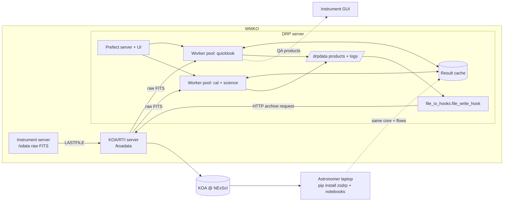
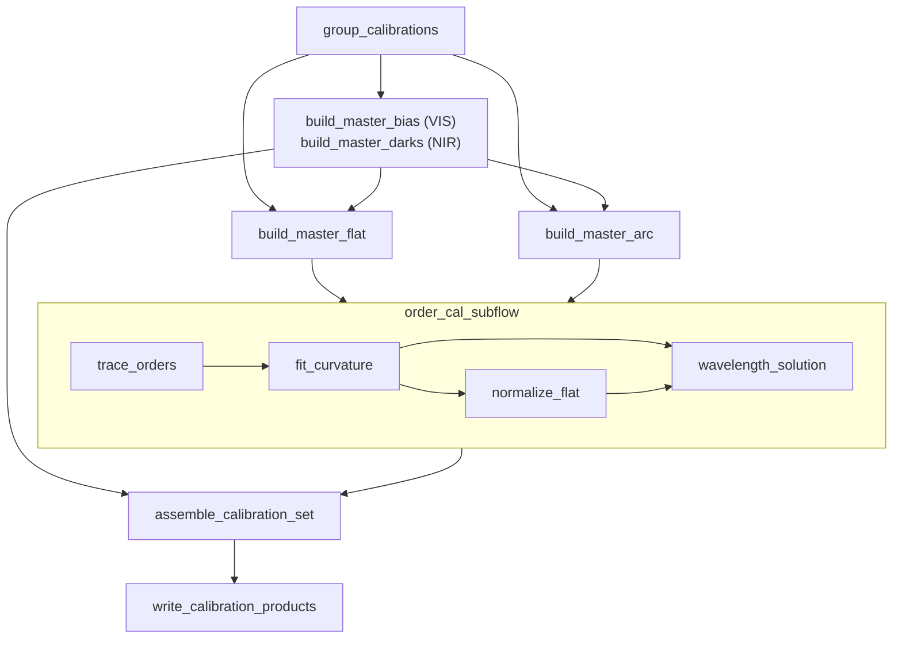
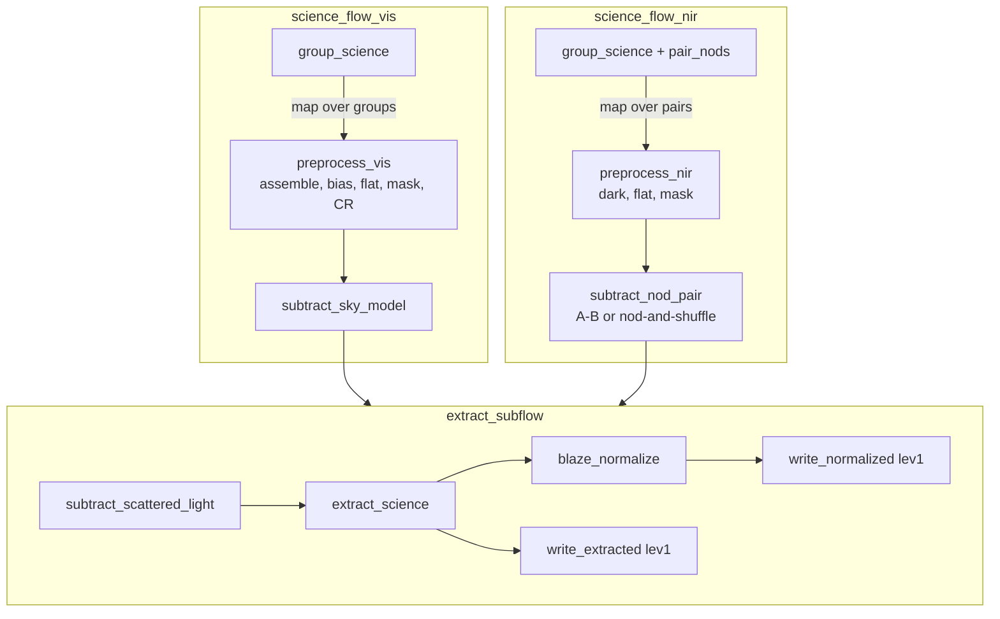

# ZShooter DRP Design

## 1. Purpose, Scope, and References

This document is the design for the ZShooter Data Reduction Pipeline (`zsdrp`). It covers the ZSpec echelle
spectrograph in full and the ZImager camera at outline level (§17).

The design is layered on four sources:

| Role | Document |
|---|---|
| Normative base architecture | [DRP Design Guidelines](https://caltechopticalobservatories.github.io/coo-software-architecture/drp_design_guidelines.html) (referred to below as *the Guidelines*) |
| Conceptual design | ZShooter CDR, Chapter 5 "Data Reduction and Simulation"  and OCDD §3.4 |
| Interface requirements | WMKO *Data Processing and Management ICD* v2.4 (referred to below as *the ICD*) |
| Prototype | Alpha PyReduce-based pipeline in `src/zsdrp/` (`pipe.py`, `steps.py`, `utils.py`, `ZSHOOTER/`) |

The Guidelines define the architectural spine: three layers, a DAG of state-aware tasks, a CAL/Quicklook/Science
flow triad joined by a content-addressed cache, a canonical data model, and header provenance. They are not restated
here. This document fills in the instrument expansion points of Guidelines §11 and adds the WMKO-specific obligations
of the ICD. Where the two disagree, §11.3 and §21 record how the conflict is resolved.

Baseline decisions:

- **Orchestrator:** [Prefect](https://www.prefect.io/), deployed as one server process plus workers (Guidelines §14).
  ICD `DRP-DEV-001` requires an SSG-approved framework. Prefect approval will be requested from the WMKO SSG before
  PDR (§21, open item O-1).
- **Support tier:** Tier 1. The DRP ships `file_io_hooks.py` and the `final` flag convention (§15).
- **Bulk reprocessing:** not planned. ZShooter has no requirement for all archival data to be reduced by
  a single pipeline release, so `DRP-REPRO-002`..`006` do not apply. The reprocessing CLI (`DRP-RUN-016`, `REQ-2-ZS-512`) is still
  provided for operational re-reductions.
- **Spectroscopic engine:** PyReduce (Piskunov et al. 2021), used through an adapter layer, following the CDR
  baseline of reusing community codes. HISPEC extraction work is an additional primitive source under the same
  contract.
- **Detector data model and preprocessing:** [eregion](https://github.com/CaltechOpticalObservatories/eregion)
  (Caltech COO), used through `core/adapters/eregion.py` under the same adapter contract. It supplies the canonical
  detector-image container (§6), raw frame loading and assembly, zero-level and flat-field combination, cosmic-ray
  masking, and the NIR ramp-to-slope fit. The HISPEC ramps-to-slopes algorithms reach the DRP generalized inside
  eregion rather than as a separate dependency.

---

## 2. Instrument Summary for the DRP

### 2.1 ZSpec

ZSpec is a suite of fixed-format echelle spectrographs that a dichroic tree splits into six channels. Each channel
has its own detector and its own reduction. The six channels fall into two arms whose reductions differ in shape:

- **VIS** (BLUE, GREEN, RED) produces one DAG shape.
- **NIR** (YJ, H, K) produces another.

Within an arm, the channel is a flow parameter (Guidelines §5.3). Across arms, the NIR reduction adds steps that the
VIS reduction does not have. These include ramp-to-slope fitting and dark subtraction in place of bias. Nod or
nod-and-shuffle sky subtraction for OH suppression may also be NIR-only, if that observing mode is adopted only for
the NIR arm (TBD with the observing-mode design). The arm is therefore a separate flow. The steps the arms share are
subflows used by both (§9).

| Arm | Channel | Detector class | Format (rows x cols) | Raw "frame" |
|---|---|----------------|---|---|
| VIS | BLUE, GREEN, RED | CCD/qCCD       | 4096 x 2048 | Read-out image (overscan, multi-amplifier) |
| NIR | YJ, H, K | H2RG/lmAPD     | 2048 x 2048 | Slope image fitted from up-the-ramp reads; ramps are not archived beyond engineering needs (CDR) |

Raw data from every channel, of either detector class, is loaded into eregion's `DetImage` (§6). Per-output gain and
read noise are measured during eregion detector characterization and reach the DRP through the header (§2.2), rather
than being re-derived from the night's bias frames.

Channel-specific static data lives in the instrument package `src/zsdrp/ZSHOOTER/`:

- `config.yaml`: header keyword map and per-order wavelength ranges for pyreduce.
- `settings.yaml` and `settings_<CHANNEL>.yaml`: reduction parameters for pyreduce.
- `free_spectral_ranges.npz`: per-order free spectral range.
- Line atlases (`thar.fits`, `thar_list.txt`, `zshooter.fits`, `zshooter_list.txt`).
- Optional static bad-pixel masks (`mask_<CHANNEL>*`).

### 2.2 Header Contract

Frame classification and calibration association use FITS headers only (`DRP-RUN-006`). The alpha currently classifies frames
with `HIERARCH IMAGETYPE` ∈ {`BIAS`, `DOMEFLAT`, `ARCS`, `SCIENCE`}, which is the keyword written by the ScopeSim
simulator.

The flight header must carry the KOA keywords: `IMTYPE` (`KOA-DATA-003`), `PROGNAME` (`KOA-DATA-002`), and the KOA
instrument keyword set (`KOA-DATA-004`). The instrument keyword map in `config.yaml` will be repointed from
`IMAGETYPE` to `IMTYPE` once the primary header is approved by the Staff Astronomer, the DRP scientist, and KOA
(`KOA-ICS-002`). Both keywords are read through the same map, so no code changes are needed when the switch happens.

The DRP also reads the following, through the `config.yaml` map:

- `INSTRUME`, `CHANNEL`, `DATE-OBS`, `OBJECT`.
- `EXPTIME`, `GAIN`, `RON`, `DARK`.
- `NAXIS1`/`NAXIS2`, and the overscan/data sections.
- `KOAID`, `PROGID`.
- `SUBTRACTED` (marks an A-B nod pair).

A required keyword that is missing raises an error for that frame, which is then handled under §13. The DRP never
substitutes a default.

### 2.3 ZImager

ZImager is a three-channel high-rate camera with a much simpler reduction. See §17.

---

## 3. System Context



The DRP server cannot read `/sdata` directly. Automated reductions take their input from RTI, either as the path of a
newly delivered file or by watching a directory (§9.5). The same package installed on a personal machine runs the
identical flows against any input directory (`DRP-RUN-003`/`004`), using a local Prefect server (or Prefect's
ephemeral mode) and a local cache.

---

## 4. Operating Modes and Entry Points

The ICD defines three operating modes and three command-line scripts. The Guidelines define the CAL/Quicklook/Science
flow triad. The table shows how they line up.

| ICD mode / script | Requirement | Flows used | Entry point |
|---|---|---|---|
| Quicklook mode | `DRP-RUN-001` (< 10 min, goal < 1 min) | `quicklook_flow_vis`/`_nir` consuming cached calibration-flow products | `zsdrp-realtime --mode quicklook`, and the core QL API (§4.1) |
| Automatic mode | ICD §"Requirements for DRPs at Runtime" | `realtime_flow` → `cal_flow_vis`/`_nir` + `science_flow_vis`/`_nir` + `flux_and_stitch_flow` | `zsdrp-realtime` |
| User mode | same | Any flow with user configuration, or core primitives called directly | Notebooks, `zsdrp-oneshot --config my.yaml` |
| One-shot script | `DRP-RUN-014` | `night_flow` (discovers, then runs cal → science → flux/stitch) | `zsdrp-oneshot <dir> [--output DIR] [--config FILE]` |
| Real-time script | `DRP-RUN-015` (24 h unattended) | `realtime_flow` | `zsdrp-realtime --watch <dir>` |
| Reprocessing script | `DRP-RUN-016` | `night_flow` mapped over several directories | `zsdrp-reprocess <dir> [<dir> ...]` |

Every script is a thin launcher. It parses arguments, loads configuration, and submits a flow run. It contains no
reduction logic.

Modes are not mutually exclusive. If measurement shows that the automatic Science flow alone meets `DRP-RUN-001` for
a channel, the QL flow for that channel can be dropped (ICD Appendix B).

### 4.1 Quick Look as an API

The CDR does not treat quick look as a separate pipeline. Instead, the instrument GUI calls the same core functions
the pipeline runs. The core layer therefore provides quick-look entry points like:

- `zsdrp.core.quicklook.reduce_frame(frame, cals, *, scatter=False, sky=False)` mutates the inbound data. It is
  called with flags that toggle scattered-light or sky removal.
- `snr_in_window(spectra, wave_min, wave_max)`.
- `annotate_lines(spectra, line_list)` for elemental lines.
- `line_width(spectra, line)` for RV and line-width checks.

These are core primitives. They have no Prefect dependency, so they run in the GUI process, in a notebook, or inside
the quicklook flows (Guidelines §5.1). The spectral extraction will use simple boxcar algorithm for fast execution 
required by quick-look.

---

## 5. Layer Architecture and Package Layout

### 5.1 Target Layout

```text
src/zsdrp/
  core/                    # pure scientific primitives (no prefect import)
    frames.py              # raw assembly, overscan, orientation, ramp -> slope
    calib.py               # bias/dark/flat combination, bad-pixel mask
    trace.py               # order tracing, slit curvature
    flat.py                # normalized flat, blaze, slit function
    wavecal.py             # arc extraction, line ID, 2D wavelength solution
    extract.py             # box and optimal extraction, sky subtraction
    fluxcal.py             # blaze normalization, sensitivity, telluric
    splice.py              # order and channel splicing
    quicklook.py           # GUI-facing helpers (Sec. 4.1)
    qa.py                  # summary statistics and QA figures
    types.py               # canonical frozen records (Sec. 6)
    adapters/
      pyreduce.py          # only module that imports pyreduce types
      scopesim.py          # simulation-truth helpers (Sec. 7.2)
      eregion.py           # for preproc and frame load
  tasks/                   # thin Prefect task wrappers (<~20 lines each)
  flows/                   # per-arm cal/quicklook/science (vis, nir), shared subflows, flux_and_stitch, night, realtime
  instrument/              # current ZSHOOTER/ package: config, settings, atlases, FSR
  io/                      # FITS readers/writers, header provenance, file naming
  file_io_hooks.py         # WMKO-owned KOA hook stub (Sec. 15)
  cli/                     # zsdrp-oneshot, zsdrp-realtime, zsdrp-reprocess
```

`tests/test_layering.py` walks the AST of every module under `core/` and fails if any of them imports `prefect`,
`zsdrp.tasks`, or `zsdrp.flows` (Guidelines §5.1, §9). Neither PyReduce nor eregion carries a Prefect dependency, so
both adapters satisfy this rule as written.

### 5.2 Mapping the Alpha `Step` Classes

The alpha's `Step` subclasses in `src/zsdrp/steps.py` each mix three things: parameter renaming, the call into
PyReduce, and file I/O (`save`/`load`). They split as follows:

| Alpha | Core primitive | Task | Notes |
|---|---|---|---|
| `MaskWrapper.run/load` | `calib.load_bad_pixel_mask` | `load_mask` (I/O task) | The static mask becomes a named mask plane on the `DetImage`. An absent mask means "no static mask", recorded in the parameters. The alpha's silent zero-mask fallback is removed. |
| `BiasWrapper.run` | `calib.master_bias` (adapter → eregion) | `build_master_bias` | |
| `FlatWrapper.run` | `calib.master_flat` (adapter → eregion) | `build_master_flat` | |
| `TraceWrapper.run` | `trace.trace_orders` (adapter → `pyreduce.trace.trace`) | `trace_orders` | The parameter-name mapping moves into the adapter. |
| `CurvatureWrapper.run` | `trace.fit_curvature` → new `TraceSet` | `fit_curvature` | The alpha mutates `traces` in place; the core version returns a new record. |
| `NormflatWrapper.run` | `flat.normalize_flat` → `NormFlat` | `normalize_flat` | |
| `WavecalWrapper.run`, `simple_wavesol` | `wavecal.solve` → `WaveSolution` | `wavelength_solution` | The alpha pops keys out of `step_cfg`; the core version takes the config read-only. |
| `ScienceWrapper.run` | `extract.optimal_extract`, `extract.box_extract` | `extract_science` (one task per object group) | Grouping by `OBJECT` becomes a visible fan-out task. |
| `BlazeNormalization.run` | `fluxcal.blaze_normalize` | `blaze_normalize` | |
| `SensitivityFunction.run` | `fluxcal.sensitivity` | `sensitivity_function` | |
| `splice`, `flux_at` | `splice.splice` | `splice_orders`, `splice_channels` | Already pure; kept as written. |
| `pipe.run_reduction`, `_run_per_channel_reduction`, `_reduce_cals` | — | — | Replaced by the per-arm calibration and science flows (§9). Disabled-step logic becomes DAG composition. |

The scientific bodies of `splice`, `flux_at`, `slit_line_profile` and the extraction calls carry over unchanged. Only
their call sites move.

---

## 6. Canonical Data Model

Every value that crosses a task boundary is one of the types below (Guidelines §5.5). The structural records are
frozen dataclasses, and arrays inside them are treated as read-only (`arr.flags.writeable = False` at construction).
The eregion containers are not frozen, so a primitive that modifies a frame returns a new `DetImage` rather than
mutating the one it was given (Guidelines §5.4).

| Type | Contents | Produced by |
|---|---|---|
| `eregion.datamodels.DetImage` | `data` plane, `std` (1-sigma), and for combined frames `count`, as named planes of an `xarray.Dataset` with dims `(y, x)`; named boolean mask planes and integer label planes; per-`Output` amplifier regions each carrying their FITS header; primary header in `meta` | Raw load, preprocessing, master calibrations, processed 2D frames |
| `eregion.datamodels.DetImage3D` | Up-the-ramp read cube, dims `(y, x, t)`, with the same `Output` regions and `meta`. Consumed by the ramp fit and not archived | Raw load, NIR |
| `ImageBundle` | Ordered `DetImage` collection with its `image_type` table, used wherever a step consumes a stack of frames | `discover_frames`, `group_calibrations` |
| `FrameRef` | Path, `KOAID`, `IMTYPE`, `CHANNEL`, `OBJECT`, `DATE-OBS`, `EXPTIME`, content fingerprint | `discover_frames` |
| `CalibrationSet` | Channel, epoch ID, and refs to master bias, dark, flat, `TraceSet`, `NormFlat`, `WaveSolution` | `cal_flow_vis` / `cal_flow_nir` |
| `TraceSet` | Per-order centre polynomials, column ranges, extraction heights, slit curvature coefficients, order numbers `m` | `trace_orders`, `fit_curvature` |
| `NormFlat` | `norm` (2D), `blaze` (n_order x n_col), `slitfunc` per order, extraction metadata | `normalize_flat` |
| `WaveSolution` | `wave` (n_order x n_col, Angstrom, air/vacuum flag), 2D polynomial coefficients, matched line table, RMS (m/s), line count | `wavelength_solution` |
| `ExtractedSpectra` | Per-order `spec`, `sig`, `wave` (optional), `cont`, `m`; header; extraction parameters | `extract_science` and later steps |
| `SensitivityCurve` | Chebyshev coefficients, wavelength domain, reference-star ID | `sensitivity_function` |

`DetImage` replaces `astropy.nddata.CCDData`, which is a CCD-shaped container: one array, one header, one
uncertainty, and no concept of amplifier regions or of a read cube. The properties that differ, and that the rest of
this document depends on:

- Uncertainty is the `std` plane and is 1-sigma, matching §14.1. The `VARIANCE` extension of §14.1 is written as
  `std**2`, so the archived product specification is unchanged.
- The pixel planes carry no unit. Flux units travel in `meta` and are written to `BUNIT` (§14.1). This is the one
  capability lost relative to `CCDData`.
- Masking is a set of named boolean planes OR-ed into a combined mask, not a single bit-flag DQ word. Each masking
  step contributes its own plane, so why a pixel is masked survives into the product (§14.1).
- `DetImage` is two-dimensional. The NIR ramp is a `DetImage3D`, which only the ramp-to-slope primitive consumes.
  Every step after it sees a `DetImage`, so the two arms share one container from the slope image onward.

`src/zsdrp/core/adapters/pyreduce.py` converts between these types and the PyReduce-native ones (`Trace`, `Spectra`,
`Spectrum`, `ExtractionParams`, the `Instrument` subclass, and header dicts). No PyReduce type appears in a task
signature. Where PyReduce mutates its inputs (`Trace.slit`, `Trace.wave`, `Trace.m`), the adapter deep-copies before
the call and builds a new record afterwards (Guidelines §5.4). PyReduce's primitives take a bare array and a header
dict, so the adapter passes `DetImage` planes straight through. `src/zsdrp/core/adapters/eregion.py` is the only
module that constructs eregion types.

Guidelines §5.5 forbids an external library's native type in a task signature, and `DetImage` does appear in task
signatures. The deviation is deliberate: eregion is adopted at the data-model layer, in the role the Guidelines
reserve for "a standard container carrying data, uncertainty, mask, and header", which is the position `CCDData`
held before. The prohibition continues to apply to algorithm-library types such as PyReduce's `Trace` and `Spectra`.
The cost is that eregion becomes a pinned data-model dependency rather than an interchangeable primitive source,
which is why it is recorded in §21.7 and in open items O-9 and O-10.

---

## 7. Primitive Inventory

This section fills in Guidelines §11.1. The first table covers ZSpec primitives.

| Primitive | Source | Types in → out | Dual-layer | Notes |
|---|---|---|---|---|
| Raw assembly and orientation | eregion | raw HDUList → `DetImage` | No | Per-`Output` assembly and pre/overscan subtraction from the eregion detector configuration; per-output gain and read noise from the header. Rotation into PyReduce orientation (`config.yaml: orientation`) stays in `zsdrp`. Not exercised by the alpha, which runs on pre-assembled simulated frames. |
| NIR ramp → slope | eregion (generalized HISPEC ramps-to-slopes) | `DetImage3D` → `DetImage` (`data` + `std`) | Candidate | Runs at the instrument or DRP ingest. Ramps are not archived (CDR). Includes reference-pixel correction, non-linearity, and jump detection, the last of which lands as a named mask plane. In development in eregion (O-9). |
| Master bias | eregion | `ImageBundle` → `DetImage` | No | CCD channels. Produces `data`, `std`, and `count` planes. Read noise is not re-derived here; it comes from the header. |
| Master dark | eregion | `ImageBundle` → `DetImage` | No | NIR channels, scaled by `EXPTIME`. |
| Bad-pixel mask | Instrument static + eregion masking | `DetImage` → named mask planes | No | Static `mask_<CHANNEL>` plus hot/dead pixels from darks and flats, each contributed as its own named plane. |
| Master flat | eregion | `ImageBundle`, bias → `DetImage` | No | Bias scaled by exposure time. The same combination builds the master arc. |
| Order tracing | PyReduce `trace.trace` | flat `DetImage` → `TraceSet` | No | Whittaker filter, `degree: 4`. The optional `order_centers` seed comes from instrument data. |
| Slit curvature | PyReduce `slit_curve.Curvature` | arc `DetImage`, `TraceSet` → `TraceSet` | No | 1D mode, `degree: 0`. The tilt is the detector rotation (see the comments in `settings.yaml`). |
| Scattered light | PyReduce `estimate_background_scatter` | `DetImage`, `TraceSet` → background model | No | Disabled in the alpha (`ReductionStep.SCATTER` is commented out). Required for the processed 2D products (CDR). |
| Normalized flat, blaze | PyReduce `extract_normalize` | flat, `TraceSet` → `NormFlat` | Yes (PyReduce `numpy` / `c` slit decomposition) | Gain, read noise, and dark come from the master-flat header. |
| Cosmic-ray rejection | eregion (L.A.Cosmic) or PyReduce optimal-extraction rejection | `DetImage` → `DetImage` | Yes | Flagged pixels are a named mask plane, and the connected-component labels are kept alongside it. VIS: single science frames; stacks use the combine-time rejection. NIR: mostly handled by jump detection in the ramp fit. |
| Wavelength solution | PyReduce `WavelengthCalibrationInitialize` + `WavelengthCalibration` | arc `DetImage`, `TraceSet` → `WaveSolution` | No | ThAr atlas (`atlas: thar`, `medium: air`), 2D polynomial `degree: 3`. Assigns order numbers from `obase`. |
| Science extraction | PyReduce `extract` (optimal), box sum (new) | `DetImage`, `TraceSet`, `NormFlat` → `ExtractedSpectra` | Yes (optimal) | Optimal extraction for Science, box extraction for Quicklook. |
| Sky subtraction, nod | Nod A-B difference (`SUBTRACTED` header) or nod-and-shuffle (new) | `DetImage` pair → `DetImage` | No | NIR arm, for OH suppression; nod-and-shuffle only if adopted (TBD). The alpha skips bias for A-B frames. |
| Sky subtraction, model | Slit-sky model (new) | `DetImage`, `TraceSet` → `DetImage` | No | VIS arm, and any non-nodded data. |
| Blaze normalization | New (`BlazeNormalization`) | `ExtractedSpectra`, `WaveSolution`, `NormFlat`, FSR → `ExtractedSpectra` | No | Trims each order to its free spectral range, then splices orders. |
| Sensitivity function | New (`SensitivityFunction`) | standard `ExtractedSpectra`, reference spectrum → `SensitivityCurve` | No | log10 ratio, median filter, sigma-clipped Chebyshev degree 6. |
| Telluric correction | Model fitting (e.g. molecfit-class) or telluric-standard division | `ExtractedSpectra` → `ExtractedSpectra` | No | Not in the alpha. CDR calibration product. |
| Order / channel splice | New (`splice`) | `ExtractedSpectra` → `ExtractedSpectra` | No | Junction where kept inverse variance per unit wavelength is maximal. Optional S/N-anchored rescale. |
| QA metrics | New (`core.qa`) | any record → `dict` + figure | No | §12.2. |

### 7.1 Dual-Layer Primitives

PyReduce puts its slit decomposition behind one call site in `pyreduce.extract`. `zsdrp` supports two of its
backends:

- `numpy`: a pure-Python port, which `zsdrp` treats as the canonical implementation.
- `c`: the vendored CFFI extension, which is PyReduce's default and which `zsdrp` treats as the compiled override
  (Guidelines §5.9).

Differential tests run both on the same fixture frames (§18). PyReduce's remaining backends are optional extras of
`pyreduce-astro` rather than core requirements, and `zsdrp` does not offer them: they add no capability that `numpy`
and `c` do not already cover, and each would add a dependency.

PyReduce reads its backend from the `PYREDUCE_EXTRACTION` environment variable. `DRP-BLD-006` forbids configuring
pipeline operation through the environment, so in `zsdrp` the backend is a configuration and CLI option
(`extraction_backend`, `--backend numpy`), which accepts `numpy` or `c`. `core/adapters/pyreduce.py` applies it to the
PyReduce call in-process. Users never set the variable, and the selected backend is part of every extraction task's
parameters and cache key. This replaces the Guidelines' "environment override".

Use of compiled code needs SSG approval under `DRP-DEV-003` (§21, open item O-2).

### 7.2 Simulation-Only Primitives

`simple_wavesol` in `src/zsdrp/steps.py` builds the wavelength image from the ScopeSim analytical trace list that
generated the frame. It reads `SIM CONFIG SIM file local_packages_path` and the `D` WCS from the header, then applies
an arc-line correction. It is a ground-truth tool for DRP development and for checking the PyReduce solution against
the simulator. It moves to `core/adapters/scopesim.py` and is never used on sky data. The production wavelength path
is `WavecalWrapper` → `wavecal.solve`.

---

## 8. Calibration Structure

This section fills in Guidelines §11.2. A calibration epoch is a contiguous interval with no change in instrument
configuration (detector settings, slit/R mode, mechanical state). Calibration association reads the epoch from
headers alone: `DATE-OBS`, the mode keywords, and the configuration keywords.

| Product | Built from | Epoch / lifetime | Cache key inputs | Written to disk as |
|---|---|---|---|---|
| Master bias (CCD) | `IMTYPE=bias`, per channel | Night | Bias frame fingerprints + `bias` settings | `<first>_mbias.fits` |
| Master dark (NIR) | `IMTYPE=dark`, per channel and `EXPTIME` | Night | Dark fingerprints + settings | `<first>_mdark.fits` |
| Bad-pixel mask | Static mask + darks/flats | Static mask: instrument release. Dynamic part: night | Inputs + settings | `<first>_bpm.fits` |
| Master flat | `IMTYPE=flatlamp`, per channel | Afternoon calibration set | Flat fingerprints + master bias key + `flat` settings | `<first>_mflat.fits` |
| `TraceSet` | Master flat | Mechanical epoch; refreshed per afternoon set | Master flat key + `trace` settings | `<first>_trace.fits` |
| Curvature (in `TraceSet`) | Master arc + `TraceSet` | Same as traces | Arc key + trace key + `curvature` settings | Same file |
| `NormFlat` | Master flat + `TraceSet` | Afternoon set | Flat key + trace key + `norm_flat` settings | `<first>_normflat.fits` |
| Master arc | `IMTYPE=arclamp`, per channel | Afternoon set (plus optional night arcs) | Arc fingerprints + bias key | `<first>_marc.fits` |
| `WaveSolution` | Master arc + `TraceSet` (+ `NormFlat`) | Afternoon set | Arc key + trace key + `wavecal_*` settings | `<first>_wavecal.fits` |
| `SensitivityCurve` | Standard-star science + reference spectrum | Night (default); any epoch by user choice | Standard spectra key + reference ID + settings | `<first>_sens.fits` |
| Telluric model | Telluric standard or model fit | Per science exposure, or per standard | Inputs + settings | `<first>_tell.fits` |

`<first>` is the filename stem of the first input file, so names follow `DRP-RUN-005`, e.g. `KB.20280101.12345_mflat.fits`.

Master calibrations are final products of the calibration flows, written as a matter of course and archived if KOA selects them
(`DRP-KOA-001`). The Quicklook and Science flows request them by cache key, and so receive cache hits rather than
rebuilding them (Guidelines §5.3). If the night's set is incomplete, association falls back only to the most recent
earlier epoch with the same configuration. That choice is logged as a decision point (`DRP-RUN-009`) and recorded in
the product header.

---

## 9. Flow Catalog

This section fills in Guidelines §11.3.

### 9.0 Arms, Channels, and Shared Subflows

Flows are defined per arm and parameterized by channel within the arm:

| Flow family | VIS (BLUE, GREEN, RED) | NIR (YJ, H, K) |
|---|---|---|
| Calibration | `cal_flow_vis` | `cal_flow_nir` |
| Quicklook | `quicklook_flow_vis` | `quicklook_flow_nir` |
| Science | `science_flow_vis` | `science_flow_nir` |

The arm flows differ only in their detector-level steps: frame preparation, the zero-level calibration, and the sky
treatment. The echelle steps after those are identical for every channel, so they live in two subflows that both arms
call:

- `order_cal_subflow(channel, master_flat, master_arc, config)` runs trace → curvature → normalized flat →
  wavelength solution.
- `extract_subflow(channel, frame, calibration_set, config)` runs scattered light → optimal extraction → blaze
  normalization → lev1 writes.

Each arm flow is shown in full in the Prefect DAG. A step that exists in only one arm appears only in that arm's flow.
It is never a branch that the other arm skips at run time, so a VIS run never shows an idle NIR-only node.

| Step | VIS | NIR |
|---|---|---|
| Raw assembly (eregion): overscan, multi-amplifier, orientation | Yes | Reference-pixel correction and orientation |
| Ramp → slope (eregion): non-linearity, jump detection | — | Yes, at ingest |
| Zero level (eregion) | Master bias | Master dark, matched in `EXPTIME` |
| Cosmic-ray rejection | eregion L.A.Cosmic on frames, or at combine | Largely handled by jump detection in the ramp fit |
| Sky | Slit-sky model or none | A-B nod pairs; nod-and-shuffle for OH suppression if adopted (TBD) |
| Order calibration, extraction, blaze normalization | `order_cal_subflow`, `extract_subflow` | Same subflows |

If nod-and-shuffle is not adopted, or is also used in VIS, the sky row becomes the same for both arms. The arm flows
then differ only in frame preparation and zero level, and the split stays as above. If a later design merges the arms
into one DAG shape, the arm flows collapse back into channel-parameterized flows without any change to tasks or core
primitives.

### 9.1 `cal_flow_vis` and `cal_flow_nir`

```text
Flow name:           cal_flow_vis / cal_flow_nir
Purpose:             Build and cache all master calibrations for one channel and epoch.
Parameters:          channel (within the arm), epoch_id, frames: list[FrameRef], config
Input discovery:     group_calibrations task (IMTYPE, CHANNEL, configuration keywords)
DAG shape:           see diagram; VIS builds a master bias, NIR builds master darks per EXPTIME
Cached products consumed: none (bias/dark from the same run)
Products produced:   CalibrationSet + FITS files of Sec. 8
Concurrency model:   per-channel runs concurrent (process pool); within a channel sequential
Timing requirement:  done before the first science frame of the night needs it; on demand otherwise
Failure behavior:    a failed product fails only its dependents; CalibrationSet records which members exist
```



The alpha's disable-step logic in `pipe._reduce_cals` becomes DAG composition. Disabling `wavecal` removes that node
and its dependents; it does not run a branch that logs a warning and returns `None`.

### 9.2 `quicklook_flow_vis` and `quicklook_flow_nir`

```text
Flow name:           quicklook_flow_vis / quicklook_flow_nir
Purpose:             Viability assessment of one exposure within DRP-RUN-001.
Parameters:          frame: FrameRef, channel (within the arm), ql_config (fixed, minimal; optional order selection)
Input discovery:     single frame from realtime_flow or the GUI
DAG shape:           VIS: assemble -> subtract bias -> flat -> box extract -> apply wave -> QA
                     NIR: subtract dark -> (A-B / nod-and-shuffle sky if the frame is part of a pair) -> flat
                          -> box extract -> apply wave -> QA
Cached products consumed: CalibrationSet for the channel (latest matching epoch)
Products produced:   QL 2D frame, QL 1D per-order spectra, QA figure + metrics (S/N per order, coverage flags)
Concurrency model:   own work pool; threads for I/O, single process for compute
Timing requirement:  < 10 min after the file arrives; goal < 1 min (DRP-RUN-001)
Failure behavior:    zero compute retries; failure appears in the GUI and does not block the next frame
```

Quicklook uses a box extraction over the cached trace with a fixed height. It does no optimal extraction, no
scattered-light fit, and no flux calibration (ICD Appendix B, Quicklook mode). The user can restrict reduction to one
channel or a range of orders. If no calibration set exists yet, the QL flow still produces a bias- or dark-subtracted
2D frame and its QA figure, and records that extraction was skipped because there were no traces.

In NIR, a frame whose nod partner has not arrived yet is reduced without sky subtraction. When the partner arrives,
the pair is reduced again. Both QL products record which sky treatment was applied.

### 9.3 `science_flow_vis` and `science_flow_nir`

```text
Flow name:           science_flow_vis / science_flow_nir
Purpose:             Full-quality reduction of all science frames for one channel.
Parameters:          channel (within the arm), frames: list[FrameRef], calibration_set, config
Input discovery:     group_science task: groups by OBJECT and, in NIR, by nod/sequence keywords (visible fan-out)
DAG shape:           VIS: per group: assemble -> bias -> combine/CR -> flat -> (sky model) -> extract_subflow
                     NIR: per group: dark -> pair A-B / nod-and-shuffle -> combine -> flat -> extract_subflow
Cached products consumed: CalibrationSet
Products produced:   processed 2D frames, per-order 1D spectra (lev1), blaze-normalized spliced spectra
Concurrency model:   groups concurrent on a process pool; chain within a group sequential
Timing requirement:  none (automatic mode: completes before next-night checkout, ICD DRP Servers)
Failure behavior:    one group's failure leaves the others intact; run state COMPLETED_WITH_FAILURES
```

`preprocess_vis` and `preprocess_nir` are thin tasks over the eregion adapter. Both end with a `DetImage` carrying
its `std` plane and the named mask planes each step contributed, so `extract_subflow` is identical for the two arms.



In the diagram, both arms feed the same `extract_subflow`. At run time each arm calls its own instance of it; the
diagram only shows that the extraction steps are shared.

### 9.4 `flux_and_stitch_flow`

```text
Flow name:           flux_and_stitch_flow
Purpose:             Flux-calibrate each channel and splice channels into one spectrum per object.
Parameters:          science results for all channels, standard-star identification, reference spectrum, config
Input discovery:     standard identified from header (target / IMTYPE / program keywords), not from a hard-coded name
DAG shape:           per channel: sensitivity_function -> apply_flux_calibration ; per object: telluric -> splice_channels
Cached products consumed: SensitivityCurve (cached per epoch), science outputs
Products produced:   flux-calibrated per-channel and stitched full-range spectra (lev2, final=True)
Concurrency model:   per object concurrent
Timing requirement:  none
Failure behavior:    if there is no standard, channels are written at blaze-normalized level and DRPSTATU=F for lev2
```

The alpha's `run_flux_calibration_and_stitch` takes the standard's name as a literal (`"STANDARD"`) and silently
defaults `EXPTIME` to 1.0. Both are removed (§20).

### 9.5 `night_flow` and `realtime_flow`

- `night_flow(input_dir, output_dir, config)`. Runs `discover_frames` (a fan-out task), then the matching arm's
  calibration flow (`cal_flow_vis` or `cal_flow_nir`) per channel and epoch, the matching arm's science flow per
  channel, and finally `flux_and_stitch_flow` across all six channels. The arm comes from the channel's header, through
  the instrument configuration. This is the body of `zsdrp-oneshot` and, mapped over directories, of
  `zsdrp-reprocess`.
- `realtime_flow(watch_dir, output_dir, config)`. A long-running loop. On each new file, which arrives from RTI or
  directory polling, it submits the arm's quicklook flow to the QL pool. Calibration frames accumulate until their set
  is complete, then the arm's calibration flow is submitted. Science frames go to the arm's science flow once a
  calibration set exists; in NIR this happens once the nod pair or sequence is complete.
  The loop holds no reduction state: everything it knows is in the Prefect run history and the cache. This lets it run
  unattended for 24 h or more (`DRP-RUN-015`), keep memory flat (`DRP-RUN-019`), and resume after a restart
  (`DRP-RUN-017`).

---

## 10. Caching and Selective Re-execution

Each cacheable task sets a Prefect `cache_key_fn` built from:

- the content fingerprints of array inputs (shape, dtype, moments) and, for `FrameRef`, the file's size, `KOAID`, and
  header checksum. Paths and mtimes are not used.
- every non-array parameter after configuration merging, i.e. the parameters as executed.
- the `zsdrp` version and the selected primitive backend.

Consequences:

- Changing one setting, for example `curvature.peak_threshold` for RED, invalidates `fit_curvature` and its
  descendants for RED only. Re-running `night_flow` then serves bias, flat, and trace from the cache.
- An interrupted run (SIGINT/SIGTERM) resumes with the next invocation by serving completed tasks from the cache
  (`DRP-RUN-017`). Termination is handled by Prefect's cancellation; the CLI registers signal handlers that cancel
  the flow run and return.
- The cache storage path and Prefect profile are per-instance configuration, so two instances on the same server
  never share locks, ports, or cache directories (`DRP-RUN-013`).
- Full-content hashing is used only in differential tests (§18).

This replaces the alpha's `reuse_cals`, which reloads `trace_<CHANNEL>.fits` / `norm_<CHANNEL>.npz` /
`wavecal_<CHANNEL>.npz` by filename inside a broad `try/except`.

---

## 11. Configuration

- **Layering.** Configuration is applied in order: the PyReduce defaults, then `instrument/settings.yaml`, then
  `instrument/settings_<CHANNEL>.yaml` (the alpha's `load_zshooter_settings` merge), then an optional user YAML, then
  CLI overrides. The installed defaults reduce ZShooter data without modification (`DRP-BLD-005`).
- **Parameters as executed.** Each task logs its fully merged parameter dict at entry, and that dict feeds both the
  cache key and the header provenance. In-code defaults that currently hide configuration move into
  `settings.yaml`, or become required:
  - `reject_threshold=6` in `NormflatWrapper`.
  - `wave_delta=20` in `WavecalWrapper`.
  - The `ExtractionParams(osample=10, lambda_sf=1.0, lambda_sp=0.0)` fallbacks in `ScienceWrapper`.
- **Read-only configuration.** Primitives never mutate the config they receive. The alpha's
  `init_step_cfg.pop('atlas')` would raise `KeyError` on a second call with the same dict.
- **Environment.** Environment variables carry only machine configuration: the Prefect API URL, cache root,
  credentials, and the KOA endpoint used by WMKO's hook. All of these appear with example values in a committed
  `.env.example` (`DRP-BLD-006`, `DRP-BLD-007`). Nothing that changes reduction behaviour is read from the
  environment.
- **Plotting.** Interactive `plot: True` settings apply to notebooks and user mode only. Flows run headless, and their
  QA figures are written as products (§12.2).

---

## 12. Observability, Logging, and QA

### 12.1 Operational Surface

The Prefect UI shows the DAG with per-task state, parameters, timing, cache-hit status, and per-task logs, for live
runs and past ones (Guidelines §5.6).

Every task writes the entry, exit, and failure fields of Guidelines §6. The task contract also requires the following:

- **Logging configuration.** Logs go to Prefect and also to files under `<log_dir>/<run_id>/<flow>/<task>.log`. The
  log directory defaults to `<output_dir>/logs` and can be set with `--log-dir` (`DRP-RUN-008`). All logs share that
  one parent directory (`DRP-RUN-010`).
- **What is logged.** Every reduction step, decision point (calibration association, epoch fallback, group
  formation), file read, file write, warning, and error. Warnings and errors name the task and the input files
  involved (`DRP-RUN-009`).
- **No `print`.** The alpha's `print(f"... parameters: {params}")` calls are replaced by entry logging.

### 12.2 Exit Statistics and QA Products

This section fills in Guidelines §11.4.

| Task | Exit summary statistics | QA product |
|---|---|---|
| `assemble_frame` | Overscan level and sigma per output, saturated fraction | — |
| `ramp_to_slope` (NIR) | Reads used, jump-flagged pixel count, saturated fraction | — |
| `build_master_bias` / `dark` | Median, robust sigma, hot-pixel count | — |
| `build_master_flat` | Median counts per order region, saturated fraction | — |
| `trace_orders` | Orders found vs. expected per channel, median order width, polynomial RMS | Trace overlay PNG |
| `fit_curvature` | Median tilt per order, number of lines used | — |
| `normalize_flat` | Blaze peak per order, fraction of `norm` outside [0.5, 1.5] | Blaze curves PNG |
| `wavelength_solution` | Lines matched, RMS in m/s and pixels, order-number base `obase` | Residuals vs. wavelength PNG |
| `extract_science` | Median S/N per order, masked-pixel fraction, CR count | 2D + 1D overview PNG |
| `blaze_normalize` | Wavelength coverage, gaps | — |
| `sensitivity_function` | Fit RMS, clipped fraction | Sensitivity PNG |
| `splice_channels` | Junction wavelengths, rescale factors | Full-range spectrum PNG |
| Quicklook | S/N per order, coverage flags, saturation flag | QL summary PNG for the GUI |

Per-exposure metadata QA (configuration, slit/R, airmass, seeing, non-sidereal rates, from the CDR) is copied from
raw headers into a QA table extension of each lev1/lev2 product.

---

## 13. Failure Handling

- **Retries** (Guidelines §5.7):
  - I/O tasks (`load_frame`, `write_*`, hook invocation): 3 retries with exponential backoff.
  - Compute tasks: 0 retries.
- **Corrupt or malformed input** (`DRP-RUN-022`). `load_frame` validates the FITS structure and the required header
  keywords. A failure marks that unit failed, records its path and the exception, and lets the rest of the batch
  continue. The frame drops out of its group, and the group reduces with the remaining frames if any are left.
- **Run state.** A run ends in one of three states: `COMPLETED`, `COMPLETED_WITH_FAILURES` (with a per-unit failure
  list in the run artifact), or `FAILED` (flow-level error only). The CLI exit code distinguishes the three.
- **Automatic-mode edge cases.** Bad calibrations, poor conditions, and contamination may legitimately fail a unit
  (ICD Appendix B). The failure is documented and the batch is not failed.
- **Re-running failures.** Re-running only the failed units is a flow re-submission. Successful units are served from
  the cache.

---

## 14. Data Products and FITS Conventions

### 14.1 Product Specification

This table is the `KOA-VOL-001`/`002` specification. It will be revised at PDR, PSR, and ORR (`KOA-VOL-005`). All
products are FITS with standard-conforming headers and extensions (`KOA-ICS-001`).

| Product | Level | Filename | Extensions | Label |
|---|---|---|---|---|
| Raw frame (CCD) / slope image (NIR) | lev0 | Instrument (KOAID) | PRIMARY header; image(s) per amplifier or slope; NIR: slope variance | Threshold |
| Master calibrations (§8) | cal | `<first>_<type>.fits` | PRIMARY; `DATA`; `VARIANCE`; `MASK`; `COUNT`; type-specific table (e.g. `TRACES`, `LINES`) | Baseline |
| Quicklook 2D + 1D | QL | `<KOAID>_ql.fits` | PRIMARY; `DATA`; `SPEC` (per-order table: m, pixel, flux, sigma, wave); `QA` | Threshold |
| Processed 2D frame | lev1 | `<KOAID>_2d.fits` | PRIMARY; `DATA`; `VARIANCE`; `MASK`; `WAVE` (2D wavelength map); `BIAS`; `FLAT`; `SCATTER`; `SKY`; `CRMASK`; WCS keywords | Baseline |
| Extracted spectra, per order | lev1 | `<KOAID>_1d.fits` | PRIMARY; `SPEC` (binary table per order: m, pixel, wave, flux, sigma, blaze); `QA` | Threshold |
| Blaze-normalized spliced spectrum, per channel | lev1 | `<KOAID>_<CHANNEL>_norm.fits` | PRIMARY; `SPEC` (wave, flux, sigma, cont) | Baseline |
| Flux-calibrated full-range spectrum | lev2 | `<first>_stitched.fits` | PRIMARY; `SPEC` (wave, flux, sigma); `TELLURIC`; `SENS`; `QA` | Baseline |
| Calibration solutions (wavelength, response, telluric) | cal | §8 | As above | Baseline |
| QA figures and tables | QA | `<KOAID>_<task>_qa.png`, `_qa.fits` | — | Optimal |

Wavelength units are Angstrom. The air/vacuum convention is recorded in `WAVEMED`. Flux units are recorded in `BUNIT`
for every image extension and in `TUNITn` for every table column. Uncertainties are 1-sigma, propagated from the raw
variance (read noise, gain, dark) through every step (ICD Appendix B, `DRP-DEV-008` "scientific validity"). The
`DetImage` `std` plane holds that 1-sigma value, and the writer squares it into the `VARIANCE` extension.

The `MASK` extension holds the combined boolean mask. The names of the mask planes that contributed to it are listed
in its header, so the reason a pixel was rejected survives archiving (§6).

### 14.2 Header Keywords

| Keyword | Content | Requirement |
|---|---|---|
| `DRPVERNO` | `zsdrp` version, SemVer (from package metadata) | `DRP-RUN-012` |
| `DRPSTATU` | `T` if the file is fully reduced for its level, `F` otherwise | `DRP-RUN-021` |
| `PROGID`, `KOAID` | Copied from the first raw input | `DRP-RUN-020` |
| `DRPRUNID` | Prefect flow-run ID | Guidelines §6.4 |
| `DRPSTnn` / `DRPPnn` | Applied step `nn` (ordered) and its key parameters as JSON | `DRP-RUN-011`, Guidelines §5.10 |
| `DRPINnn` | Input frames and calibration products consumed | Guidelines §5.10 |
| `DRPSTART` | ISO-8601 UTC start of reduction of this file | `DRP-KOA-005` |

When the parameter set is too large for header cards, it goes in a dedicated `PROVENANCE` binary-table extension
(one row per step), as `DRP-RUN-011` allows. The pipeline never reads these keywords to decide control flow.

### 14.3 Writing Rules

- **Permissions.** In automatic mode, files are written with mode `0o644` by a non-root service account. They are
  never world-writable or executable (`DRP-RUN-007`).
- **Intermediates.** Intermediate products stay in the result cache. They are serialized to FITS only on request
  (`zsdrp export <run_id> <task>`). The alpha's `.npz` side-effect writes are removed. eregion serializes a
  `DetImage` to netCDF, which is the cache representation of a 2D frame; every archived product is FITS written by
  `zsdrp.io` (`KOA-ICS-001`).
- **Output directories.** Default output and log directories are created on first invocation (`DRP-BLD-003`). Any
  output location can be given at runtime (`DRP-RUN-004`).

---

## 15. KOA / RTI Integration

`src/zsdrp/file_io_hooks.py` ships with exactly the following content. WMKO overwrites this file at Keck deployments
(`DRP-KOA-002`, `DRP-KOA-003`). Changing its signature or how it is invoked requires SSG approval.

```python
def file_write_hook(koaid: str, filepath: str, start_time: str, final: bool = False, data_level: str = 'lev1'):
    pass
```

- Every writer of a user-facing product (`io.write_ql`, `write_2d`, `write_extracted`, `write_normalized`,
  `write_stitched`, `write_calibration`) takes a `final: bool` argument (`DRP-KOA-004`). `final` equals the
  `DRPSTATU` value written to that file.
- When `final` is `True`, the writer calls `file_write_hook` after the file has been closed on disk, with `koaid`,
  the absolute path, the ISO-8601 UTC `start_time` of that file's reduction, and `data_level` ∈ {`ql`, `lev1`,
  `lev2`, `cal`} (`DRP-KOA-005`, `DRP-KOA-006`).
- The hook is called from the write task, so it runs under the I/O retry policy and its outcome is visible in the DAG.
- The list of archived products for quick-look and science-ready modes will be agreed with the Staff Astronomer and
  KOA scientist and presented at PSR (`DRP-KOA-001`). §14.1 is the starting proposal.

---

## 16. Deployment, Build, and Resources

### 16.1 Development and Build

- Python ≥ 3.12 (`requires-python = ">=3.12"` already set), with no `__future__` imports (`DRP-DEV-002`).
- Developed on GitHub, then transferred to the `Keck-DataReductionPipelines` organization at delivery
  (`DRP-DEV-004`, `DRP-DEV-005`). Released as open source after OHR under BSD 3-Clause, which is preferred by WMKO
  (`DRP-DEV-006`). The current `pyproject.toml` declares MIT, so the license change is an open item (§20).
- PEP 8 compliance is checked by a linter in CI (`DRP-DEV-007`). No automatic reformatter is used.
- Targets Ubuntu 24.04 LTS, with macOS supported for users (`DRP-DEV-011`).
- Installation: `pip install zsdrp` (PyPI, from the CDR) or `uv sync` from the committed `uv.lock`. Top-level
  dependencies are pinned. The build system (setuptools, uv) is subject to SSG approval (`DRP-BLD-001`). eregion is
  a pinned top-level dependency; its PyPI release is scheduled before PDR, and until then it installs from the COO
  GitHub repository at a pinned revision (§21, open item O-10).
- Static files (line atlases, FSR tables, static masks, reference spectra) are fetched by a post-install step that
  checks checksums. WMKO can serve the files (`DRP-BLD-008`). The step runs automatically on first import if it has
  not been run before, so the DRP runs straight after clone and build (`DRP-BLD-004`).
- The Prefect database is SQLite in local mode and is created automatically on first run. No other database is
  needed (`DRP-BLD-002`).

### 16.2 Runtime Footprint on the WMKO DRP Server

The DRP server has 24 cores, about 400 GB RAM, a 32 TB HDD, and a 1 TB NVMe disk. The deployment on it is one Prefect
server and two work pools:

| Pool | Purpose | Concurrency limit (initial) | Executor |
|---|---|---|---|
| `zs-quicklook` | `quicklook_flow_vis`, `quicklook_flow_nir` | 6 (one per channel) | Single process per run |
| `zs-science` | `cal_flow_vis`/`_nir`, `science_flow_vis`/`_nir`, `flux_and_stitch_flow` | 12 worker processes | Process pool |

The QL pool has reserved capacity and the science pool is capped, so neither mode starves the other (`DRP-RUN-002`).
QL timing is measured with the science pool saturated, because `DRP-RUN-001` applies under concurrent load.

Process-based workers are recycled after each flow run. Results are persisted to the cache rather than held in worker
memory. Together these give no net memory growth after one-shot or reprocessing runs (`DRP-RUN-018`) and flat
steady-state use in real-time mode (`DRP-RUN-019`). Both are verified by profiling in CI (§18). Reduction resources
are released before next-night checkout.

### 16.3 Data Volume

`KOA-VOL-003`/`004` are instrument-team deliverables due at PDR. The DRP contribution is the per-frame size of each
product:

| Frame | Pixels | Size |
|---|---|---|
| CCD raw (16-bit, assumed) | 4096 x 2048 | 16 MiB plus overscan |
| NIR slope (float32) | 2048 x 2048 | 16 MiB, or 32 MiB with variance |
| NIR ramp (`DetImage3D`, float32), held in memory during the fit only | 2048 x 2048 x n_reads | about 512 MiB at 32 reads |
| Processed 2D, CCD (float32 data + variance + wave, 8-bit mask, correction maps) | 4096 x 2048 | about 100–160 MiB depending on the correction maps kept |
| Extracted 1D per channel | n_order x 2048 x 6 columns | < 5 MiB |

Per-hour and per-night totals depend on the exposure and calibration cadence of the observing plan and are TBD at
PDR. Which correction-map extensions are archived (§14.1) is the main reduced-volume lever, and is set under
`DRP-KOA-001`.

---

## 17. ZImager (Outline)

ZImager is a three-channel astrophysical camera. Its reduction is simpler than ZSpec's, but its data rate is much
higher. Run continuously, it could deliver about 135 TiB per night (CDR).

- **Flows.** The same triad with `channel` as the parameter. `cal_flow`: master bias/dark, flat, and non-linearity
  calibration. `quicklook_flow`: bias, flat, and a sampled-frame preview. `science_flow`: bias/dark, non-linearity,
  flat, CR rejection, astrometric WCS, and stacking/photometry products.
- **Non-linearity.** A low-light non-linear response correction, of the kind identified for the Lightspeed
  pathfinder, is planned if issues remain in the delivered Hamamatsu sensors. It is an eregion primitive, simple per
  pixel but compute-heavy at ZImager rates. It is a dual-layer primitive: readable NumPy as canonical, with a GPU
  backend as the override.
- **I/O.** Streaming blosc2 compression and possibly HDF5 containers for high-rate cubes. The canonical data model
  gains a chunked cube type whose chunks are the fan-out units; because `DetImage` is already backed by named xarray
  planes, that is a chunked form of the same container rather than a second data model. eregion's focal-plane
  mosaicking assembles the three channels. Archived products remain FITS (`KOA-ICS-001`). Any non-FITS intermediate
  stays in the cache.
- **Resources.** 135 TiB/night is far beyond the WMKO DRP server's 32 TB HDD and 1 TB NVMe. Expected operational
  duty cycle, on-the-fly reduction or decimation, and whether ZImager-specific compute or storage must be procured
  with a spare (`DRP-DEV-012`) are to be raised with SSG and settled at PDR (§21, open item O-5).

---

## 18. Testing and Verification

| Test | What it establishes | Requirement |
|---|---|---|
| `test_layering.py` | `core/` imports no task, flow, or Prefect module | Guidelines §5.1, §9 |
| Core unit tests | Physical relationships on small synthetic inputs (e.g. splice preserves flux where pieces agree; sensitivity curve recovers a known response) | `DRP-DEV-008` |
| Dual-layer differential tests | Canonical and compiled backends agree within documented tolerance (full-content comparison) | Guidelines §5.9 |
| Flow fixture tests | The calibration, quicklook, and science flows of both arms, plus `flux_and_stitch_flow`, run end to end on a small set simulated by ScopeSim (`zs-scopesim`), comparing wavelength and flux against the simulation truth. Covers at least one VIS and one NIR channel, and a NIR nod sequence | `DRP-DEV-008` (one test per mode) |
| Raw-format tests | eregion assembly and orientation on a raw multi-output frame with overscan (VIS), and a ramp cube to slope (NIR), not only pre-assembled simulations | Guidelines §9 |
| Adapter round-trip test | `DetImage` → PyReduce arrays → `DetImage` preserves data, mask planes, and header | Guidelines §5.5 |
| Corrupt-input test | A batch with one truncated FITS completes as `COMPLETED_WITH_FAILURES` | `DRP-RUN-022` |
| Memory / CPU profiling | No net growth over repeated one-shot runs and over a long `realtime_flow` soak | `DRP-RUN-018`, `DRP-RUN-019` |
| Concurrent-instance test | Two instances with different profiles and cache roots on disjoint inputs | `DRP-RUN-013` |
| QL latency test | Per-channel QL time under a saturated science pool | `DRP-RUN-001` |
| Header test | Every written product carries `DRPVERNO`, `DRPSTATU`, `PROGID`, `KOAID`, and provenance | `DRP-RUN-011/012/020/021` |
| Hook test | `file_write_hook` called once per `final=True` product with correctly formatted arguments | `DRP-KOA-003..006` |

Tests run in GitHub Actions CI. A public test dataset that covers every DRP mode and primary science case (kilonovae,
stellar, white dwarf, exomoons, comets, following the ZShooter science notebooks) will be selected and made available
through KOA no later than ORR (`DRP-DEV-009`). Before first light, the fixture set is simulated. On-sky
commissioning data replaces it.

---

## 19. Documentation Plan

Documentation is built with Sphinx and MyST (`docs/source/`) and hosted on Read the Docs. Docstrings use numpydoc
format. The `DRP-DEV-010` items map to pages as follows:

| Item | Location |
|---|---|
| Requirements | This document §21 |
| Installation | `getting-started` |
| Algorithms and reduction flow | This document §7–§9; per-primitive API docs |
| Command-line interfaces | `cli` page (generated from argparse) |
| Customization | Configuration guide (§11 expanded) |
| Data products | This document §14 |
| Common errors and failure modes | Troubleshooting page, keyed on task names and their exit statistics |
| Cookbooks | Notebooks on the `DRP-DEV-009` dataset (extending `notebooks/extraction_demo.ipynb`) |
| Code comments and docstrings | In source |

A code of conduct (Astropy-style) is linked from the documentation index (ICD Appendix C).

---

## 20. Gap Analysis: Alpha → Target

| Alpha behaviour (`src/zsdrp/`) | Target |
|---|---|
| `pipe.run_reduction` is a driver script. Step order and skips are `if` blocks; results are a nested dict | Prefect flows (§9); state lives in the orchestrator |
| `reuse_cals` reloads calibrations by filename in a broad `try/except` | Content-keyed cache (§10) |
| `Step` subclasses mix parameter mapping, PyReduce calls, and file I/O | Core primitive + adapter + thin task (§5.2) |
| `CurvatureWrapper` mutates `Trace` objects in place; `WavecalWrapper` sets `t.wave = None` and `t.m` | Copy-and-return in the adapter (§6) |
| `WavecalWrapper` pops `atlas` out of the caller's config dict | Read-only config (§11) |
| In-code defaults (`reject_threshold`, `wave_delta`, `osample`, `EXPTIME` → 1.0, `"STANDARD"`) | Configuration data; required keywords fail naturally (§11, §9.4) |
| `MaskWrapper` returns an all-zero mask when the file is missing | Absence recorded explicitly; no manufactured mask (§5.2) |
| `print` for parameters; `logger.warning` for skipped steps | Task entry/exit logging; DAG composition (§12) |
| `.npz` and ad-hoc FITS side-effect writes; ASCII spectra | Cache for intermediates; FITS products per §14 |
| `combine_calibrate` called twice on the same arcs (curvature, then wavecal) | One `build_master_arc` node consumed by both |
| `free_spectral_range[1:]` hack for RED (`pipe.py`) | FSR table indexed by order number `m` from the `TraceSet` |
| Hard-coded `2048` in `BlazeNormalization` | Column count from the frame shape |
| `simple_wavesol` reads ScopeSim configuration from headers | Simulation-only adapter (§7.2) |
| No raw assembly and no detector data model; runs on pre-assembled simulated frames | eregion `DetImage` at ingest for both arms (§6, §7) |
| Scattered light disabled; no CR, sky model, telluric, or dark | Primitives listed in §7 |
| No `DRPVERNO`, `DRPSTATU`, `PROGID`/`KOAID` propagation, provenance, or KOA hook | §14.2, §15 |
| No CLI | `zsdrp-oneshot`, `zsdrp-realtime`, `zsdrp-reprocess` (§4) |
| Classification on `HIERARCH IMAGETYPE` (simulator) | `IMTYPE` via the keyword map (§2.2) |
| License MIT | BSD 3-Clause (`DRP-DEV-006`) |
| Package data in `pyproject.toml` names a `ZSHOOTER` package and omits `.npz`/`.dat` | Static-file fetch step (§16.1) |

---

## 21. ICD Compliance Matrix

Status key:

- **D**: designed in this document.
- **P**: pending external approval or decision.
- **IT**: instrument-team or ICS responsibility; the DRP consumes the result.
- **N/A**: does not apply, with the reason given.

### 21.1 Raw Data and Volume

| ID | Summary | How satisfied | § | Status |
|---|---|---|---|---|
| KOA-ICS-001 | FITS standard | All products FITS; validated on write | 14.1 | D |
| KOA-ICS-002 | Primary header approval | DRP scientist co-signs; keyword map in `config.yaml` | 2.2 | IT/P |
| KOA-DATA-001 | `LASTFILE` keyword per detector | ICS keyword; `realtime_flow` can consume it via RTI | 3 | IT |
| KOA-DATA-002 | `PROGNAME` | Read and propagated | 2.2 | IT |
| KOA-DATA-003 | `IMTYPE` | Classification keyword | 2.2 | IT |
| KOA-DATA-004 | KOA instrument keywords | Required-keyword list in `config.yaml` | 2.2 | IT |
| KOA-VOL-001 | Product specification incl. extensions | Product table | 14.1 | D |
| KOA-VOL-002 | Threshold/baseline/optimal labels | Product table | 14.1 | D |
| KOA-VOL-003 | Raw volume per hour/night | Per-frame sizes; totals at PDR | 16.3 | P |
| KOA-VOL-004 | Reduced volume per hour/night | Per-frame sizes; totals at PDR | 16.3 | P |
| KOA-VOL-005 | Update at PDR/PSR/ORR | This document revised at each review | 14.1 | D |

### 21.2 Development

| ID | Summary | How satisfied | § | Status |
|---|---|---|---|---|
| DRP-DEV-001 | SSG-approved framework | Prefect; approval requested before PDR | 1, 16 | P (O-1) |
| DRP-DEV-002 | Python ≥ 3.12 | `requires-python >= 3.12` | 16.1 | D |
| DRP-DEV-003 | Non-Python code approval | PyReduce C/CFFI extraction; optional GPU (ZImager) | 7.1, 17 | P (O-2) |
| DRP-DEV-004 | GitHub | Repository on GitHub | 16.1 | D |
| DRP-DEV-005 | Transfer to WMKO organization | At delivery | 16.1 | D |
| DRP-DEV-006 | Open source after OHR | BSD 3-Clause (relicense from MIT) | 16.1, 20 | P |
| DRP-DEV-007 | PEP 8 | CI lint | 16.1 | D |
| DRP-DEV-008 | Automated tests, scientific validity | Per-mode end-to-end tests against simulation truth | 18 | D |
| DRP-DEV-009 | Public test dataset by ORR | Selected per mode and science case | 18 | D |
| DRP-DEV-010 | Documentation contents | Documentation plan | 19 | D |
| DRP-DEV-011 | Ubuntu 24.04 | CI target | 16.1 | D |
| DRP-DEV-012 | New servers delivered with spare | Only if ZImager compute requires it | 17 | P (O-5) |
| DRP-DEV-013 | Future versions comply | Compliance matrix maintained per release | 21 | D |

### 21.3 Installation and Build

| ID | Summary | How satisfied | § | Status |
|---|---|---|---|---|
| DRP-BLD-001 | Build system approved | setuptools + uv; submitted with O-1 | 16.1 | P |
| DRP-BLD-002 | Databases auto-created | Prefect SQLite created on first run | 16.1 | D |
| DRP-BLD-003 | Default output directories | Created on first invocation | 14.3 | D |
| DRP-BLD-004 | Runs after clone + fetch + build | Static-file fetch on install or first import | 16.1 | D |
| DRP-BLD-005 | No config edits needed | Installed defaults reduce ZShooter data | 11 | D |
| DRP-BLD-006 | No environment-variable pipeline configuration | Backend switch and all parameters via config/CLI | 7.1, 11 | D |
| DRP-BLD-007 | `.env` with examples | `.env.example` committed | 11 | D |
| DRP-BLD-008 | Static files auto-downloaded | Checksummed fetch | 16.1 | D |

### 21.4 Runtime

| ID | Summary | How satisfied | § | Status |
|---|---|---|---|---|
| DRP-RUN-001 | QL < 10 min (goal < 1 min) | Per-arm quicklook flows, box extraction, reserved pool; measured under load | 9.2, 16.2 | D |
| DRP-RUN-002 | QL and science do not interfere | Separate work pools and concurrency limits | 16.2 | D |
| DRP-RUN-003 | Input from any location | CLI and flow parameters | 4 | D |
| DRP-RUN-004 | Output to any location | CLI and flow parameters | 14.3 | D |
| DRP-RUN-005 | Multi-input filename `<first>_<type>` | Calibration and stitched naming | 8, 14.1 | D |
| DRP-RUN-006 | Metadata from headers only | `FrameRef` from headers; no filename parsing | 2.2, 8 | D |
| DRP-RUN-007 | File permissions | `0o644`, non-root | 14.3 | D |
| DRP-RUN-008 | Configurable log location | `--log-dir` | 12.1 | D |
| DRP-RUN-009 | Log steps, decisions, I/O, warnings/errors with cause and inputs | Task contract | 12.1 | D |
| DRP-RUN-010 | One log parent directory | `<log_dir>/<run_id>/...` | 12.1 | D |
| DRP-RUN-011 | Processing steps in header or extension | `DRPSTnn`/`DRPPnn`/`PROVENANCE` | 14.2 | D |
| DRP-RUN-012 | `DRPVERNO` SemVer | From package version | 14.2 | D |
| DRP-RUN-013 | Concurrent instances | Per-instance profile, port, and cache root | 10 | D |
| DRP-RUN-014 | One-shot script | `zsdrp-oneshot` | 4 | D |
| DRP-RUN-015 | Real-time script, 24 h | `zsdrp-realtime` (stateless loop) | 9.5 | D |
| DRP-RUN-016 | Reprocessing script | `zsdrp-reprocess` | 4 | D |
| DRP-RUN-017 | Safe termination and resume | Flow cancellation; cache-based resume | 10 | D |
| DRP-RUN-018 | No net memory growth | Recycled process workers; profiling | 16.2, 18 | D |
| DRP-RUN-019 | Steady-state real-time resources | Same | 16.2, 18 | D |
| DRP-RUN-020 | Propagate `PROGID`, `KOAID` | Header writer | 14.2 | D |
| DRP-RUN-021 | `DRPSTATU` | Header writer = `final` | 14.2, 15 | D |
| DRP-RUN-022 | Skip corrupt input gracefully | Unit-level failure isolation | 13 | D |

### 21.5 KOA Interface

| ID | Summary | How satisfied | § | Status |
|---|---|---|---|---|
| DRP-KOA-001 | Archived product list at PSR | Starting proposal in §14.1 | 15 | P |
| DRP-KOA-002 | `file_io_hooks.py` present | Shipped stub | 15 | D |
| DRP-KOA-003 | Hook signature | Exact signature | 15 | D |
| DRP-KOA-004 | `final` argument on user-facing writers | All `io.write_*` | 15 | D |
| DRP-KOA-005 | Hook invoked when `final`; ISO-8601 `start_time` | Write task | 15 | D |
| DRP-KOA-006 | `final` identifies complete files | `final` = `DRPSTATU` | 15 | D |

### 21.6 Bulk Reprocessing

| ID | Summary | Status |
|---|---|---|
| DRP-REPRO-001 | Declare intent by CDR | D: ZShooter declares no periodic bulk reprocessing |
| DRP-REPRO-002 | Frequency, storage, cost estimate | N/A: no bulk reprocessing |
| DRP-REPRO-003 | "Data Reprocessing Procedure" document | N/A: no bulk reprocessing |
| DRP-REPRO-004 | "Data Reprocessing Conditions" document | N/A: no bulk reprocessing |
| DRP-REPRO-005 | Review of the above per release | N/A: no bulk reprocessing |
| DRP-REPRO-006 | Public record of reprocessing events | N/A: no bulk reprocessing |

If a later science case requires uniform reprocessing, `DRP-REPRO-002`..`006` apply from that point. The
content-keyed cache and `zsdrp-reprocess` already provide the mechanics.

### 21.7 Appendix C Recommendations

| Recommendation | Position |
|---|---|
| 1. Code of conduct | Adopted (§19) |
| 2. Documentation (Astropy style, numpydoc, Read the Docs) | Adopted (§19) |
| 3. Continuous integration | GitHub Actions (§18) |
| 4. Minimize dependencies | Core stack is numpy, scipy, astropy, matplotlib, numba. **Deviation:** `pyreduce-astro`, `eregion`, `prefect`, `pyyaml`, `tqdm`, and eregion's own footprint (`xarray`, `pydantic`, `pandas`, `h5netcdf`, `lacosmic`, `pint`, `joblib`, `uncertainties`). To be reported to the Data Services Lead Scientist (O-3) |
| 5. Re-use existing code | PyReduce, eregion (which carries the generalized HISPEC ramps-to-slopes algorithms), HISPEC extraction work, and PypeIt as primitive sources; contributions back to Astropy/specreduce (CDR) |
| 6. Develop for re-use | Core primitives operate on arrays and canonical types and do not assume a FITS layout |
| 7. Clear error messages | Per-task failure fields name the task and its inputs (§12, §13) |
| 8. No hard-coded values | Header keywords, then configuration files, then named constants (§11, §20) |

### 21.8 Open Items and Risks

| ID | Item | Owner | Due |
|---|---|---|---|
| O-1 | SSG approval of Prefect as the reduction framework (`DRP-DEV-001`, `DRP-BLD-001`). Tier 1 status depends on it. If refused, the core and task layers are unchanged and only `flows/` is ported to the Keck DRP Framework | DRP lead + SSG | Before PDR |
| O-2 | SSG approval of PyReduce's C/CFFI extension and any GPU backend (`DRP-DEV-003`). The pure-Python `numpy` backend is the fallback if approval is refused | DRP lead + SSG | PDR |
| O-3 | Dependency deviations (Appendix C #4) | DRP lead | PDR |
| O-4 | Primary header content and the `IMTYPE` / KOA keyword set (`KOA-ICS-002`) | ICS + SA + KOA + DRP | Before ICS delivery |
| O-5 | ZImager data rate vs. WMKO DRP server capacity; any extra hardware and spare (`DRP-DEV-012`) | Instrument team + SSG | PDR |
| O-6 | Per-hour and per-night data volumes (`KOA-VOL-003`/`004`) | Instrument team | PDR |
| O-7 | Measured QL latency per channel; waiver request if any channel exceeds 10 min | DRP lead | PSR |
| O-8 | Sky-subtraction observing modes per arm (A-B nod, nod-and-shuffle for OH suppression, or neither), which fix the final VIS/NIR DAG difference (§9.0) | Instrument + science teams | PDR |
| O-9 | eregion NIR readiness: the `DetImage3D` container and the generalized HISPEC ramp-to-slope, jump-detection, non-linearity, and reference-pixel algorithms (§6, §7) | DRP lead + COO | PDR |
| O-10 | eregion PyPI release and version pin, which `DRP-BLD-004` and the §16.1 install path depend on | DRP lead + COO | Before PDR |

---

## 22. Glossary

| Term | Meaning |
|---|---|
| Arm | Group of ZSpec channels that share one DAG shape: VIS (BLUE, GREEN, RED) or NIR (YJ, H, K) |
| Channel | One ZSpec detector (BLUE, GREEN, RED, YJ, H, K) or ZImager band |
| `DetImage` / `DetImage3D` | eregion's detector-image containers: named xarray planes, per-`Output` regions, named mask planes. The 3D form holds an up-the-ramp read cube |
| `Output` | One amplifier or readout region of a detector, with its own header and mask planes |
| Epoch | Interval of unchanged instrument configuration over which a calibration product is valid |
| FSR | Free spectral range of an echelle order |
| lev0 / lev1 / lev2 | Raw; reduced per exposure (2D, extracted); science-ready (flux-calibrated, stitched) |
| QL | Quicklook |
| RTI | WMKO Real-Time Ingestion |
| SA | WMKO Staff Astronomer |
| SSG | WMKO Scientific Software Group |
| Task / flow | Prefect units corresponding to the Guidelines' task and flow layers |
