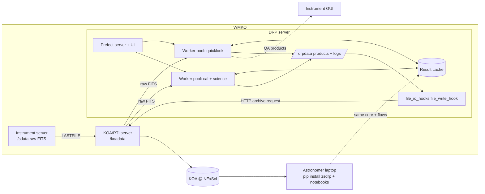

# Purpose, Instrument, and Operating Modes

## 1. Purpose, Scope, and References

This document is the design for the ZShooter Data Reduction Pipeline (`zsdrp`). It covers the ZSpec echelle
spectrograph in full and the ZImager camera in outline (§17).

It draws on four sources:

| Role | Document |
|---|---|
| Required base architecture | [DRP Design Guidelines](https://caltechopticalobservatories.github.io/coo-software-architecture/drp_design_guidelines.html) (referred to below as *the Guidelines*) |
| Conceptual design | ZShooter CDR, Chapter 5 "Data Reduction and Simulation"  and OCDD §3.4 |
| Interface requirements | WMKO *Data Processing and Management ICD* v2.4 (referred to below as *the ICD*) |
| Prototype | Alpha PyReduce-based pipeline in `src/zsdrp/` (`pipe.py`, `steps.py`, `utils.py`, `ZSHOOTER/`) |

The Guidelines define the base architecture: three layers, a DAG of tasks, calibration, quicklook and science
flows joined by a content-addressed cache, a canonical data model, and header provenance. They are not restated
here. This document covers the instrument-specific parts left open in Guidelines §11 and adds what the ICD
requires. Where the two disagree, §11.3 and §20.7 record how that is resolved.

Baseline decisions:

- **Orchestrator:** [Prefect](https://www.prefect.io/), deployed as one server process plus workers (Guidelines §14).
  ICD `DRP-DEV-001` requires an SSG-approved framework. Prefect approval will be requested from the WMKO SSG before
  PDR (§20.8, open item O-1).
- **Support tier:** Tier 1. The DRP ships `file_io_hooks.py` and the `final` flag convention (§15).
- **Bulk reprocessing:** not planned. ZShooter has no requirement for all archival data to be reduced by
  a single pipeline release, so `DRP-REPRO-002`..`006` do not apply. The reprocessing CLI (`DRP-RUN-016`, `REQ-2-ZS-512`) is still
  provided for operational re-reductions.
- **Spectroscopic engine:** PyReduce (Piskunov et al. 2021), used through an adapter layer, following the CDR
  baseline of reusing community codes. 
- **Detector data model and preprocessing:** [eregion](https://github.com/CaltechOpticalObservatories/eregion)
  (Caltech COO), used through `core/adapters/eregion.py` under the same adapter contract. It supplies the canonical
  detector-image container (§6), raw frame loading and assembly, zero-level and flat-field combination, cosmic-ray
  masking, and the NIR ramp-to-slope fit (if needed, relevant algorithms ported from HISPEC DRP into eregion core). 

## 2. Instrument Summary for the DRP

### 2.1 ZSpec

ZSpec is a suite of fixed-format echelle spectrographs that a dichroic tree splits into six channels. Each channel
has its own detector and its own reduction. The six channels fall into two arms, which reduce differently:

- **VIS** (BLUE, GREEN, RED) uses one DAG.
- **NIR** (YJ, H, K) uses another.

Within an arm, the channel is a flow parameter (Guidelines §5.3). The NIR reduction adds steps the VIS one does not
have: ramp-to-slope fitting, and dark subtraction instead of bias. Nod or nod-and-shuffle sky subtraction for OH
suppression may also be NIR-only, if that observing mode is adopted for the NIR arm alone (TBD with the
observing-mode design). Each arm is therefore its own flow, and the steps they share are subflows both call (§9).

| Arm | Channel | Detector class | Format (rows x cols) | Raw "frame" |
|---|---|----------------|---|---|
| VIS | BLUE, GREEN, RED | qCCD (CCD)     | 4096 x 2048 | Read-out image (overscan, multi-amplifier) |
| NIR | YJ, H, K | lmAPD (H2RG)   | 2048 x 2048 | Slope image fitted from up-the-ramp reads; ramps are not archived beyond engineering needs (CDR) |

Raw data from every channel, of either detector class, is loaded into eregion's `DetImage` (§6). Per-output gain
and read noise are measured during eregion detector characterization and come in through the header (§2.2); they are
not re-derived from the night's bias frames.

Channel-specific static data lives in the pyreduce `Instrument` subclass package `src/zsdrp/ZSHOOTER/`:

- `config.yaml`: header keyword map and per-order wavelength ranges for pyreduce.
- `settings.yaml` and `settings_<CHANNEL>.yaml`: reduction parameters for pyreduce.
- `free_spectral_ranges.npz`: per-order free spectral range.
- Line atlases (`thar.fits`, `thar_list.txt`, `zshooter.fits`, `zshooter_list.txt`).
- Optional static bad-pixel masks (`mask_<CHANNEL>*`).

### 2.2 ZImager

ZImager is a three-channel high-rate camera with a much simpler reduction. See §17.

Questions for Geoffrey:
- Build on heritage (Cerberus, light speed)? Or only use their algorithms with a different orchestrator/architecture?
- What needs to be stored for high cadence mode observations? All raw data or just processed light curves?
- Processing level offered - astrometric calibration (yes), photometric calibration (yes), image subtraction (?), aperture or PSF photometry (?)

### 2.3 Header Contract

Frame classification and calibration association use FITS headers only (`DRP-RUN-006`). The alpha currently classifies frames
with `HIERARCH IMAGETYPE`, one of `BIAS`, `DOMEFLAT`, `ARCS` or `SCIENCE`, which is the keyword the ScopeSim
simulator writes.

The flight header must carry the KOA keywords: `IMTYPE` (`KOA-DATA-003`), `PROGNAME` (`KOA-DATA-002`), and the KOA
instrument keyword set (`KOA-DATA-004`). The instrument keyword map in `config.yaml` will be repointed from
`IMAGETYPE` to `IMTYPE` once the primary header is approved by the Staff Astronomer, the DRP scientist, and KOA
(`KOA-ICS-002`). Both are read through the same map, so the switch needs no code change.

The alpha-DRP also reads the following, through the `config.yaml` map:

- `INSTRUME`, `CHANNEL`, `DATE-OBS`, `OBJECT`.
- `EXPTIME`, `GAIN`, `RON`, `DARK`.
- `NAXIS1`/`NAXIS2`, and the overscan/data sections.
- `KOAID`, `PROGID`.
- `SUBTRACTED` (marks an A-B nod pair).

A missing required keyword raises an error for that frame, handled under §13. The DRP never substitutes a
default.

## 3. System Context

The DRP server cannot read `/sdata` directly. Automated reductions take their input from RTI, either as the path of a
newly delivered file or by watching a directory (§9.5). Installed on a personal machine, the same package runs the
same flows on any input directory (`DRP-RUN-003`/`004`), using a local Prefect server (or Prefect's ephemeral mode)
and a local cache.

## 4. Operating Modes and Entry Points

The ICD defines three operating modes and three command-line scripts. The Guidelines define the calibration,
quicklook and science flows. The table shows how they line up.

| ICD mode / script | Requirement                                                                 | Flows used | Entry point                                                   |
|---|-----------------------------------------------------------------------------|---|---------------------------------------------------------------|
| Quicklook mode | `REQ-2-ZS-515` (goal < 10 s), within `DRP-RUN-001` (< 10 min, goal < 1 min) | `quicklook_flow_vis`/`_nir`, per channel, consuming cached calibration products when they exist | Automatic on readout; GUI re-trigger; core QL primitives (§4.1) |
| Automatic mode | ICD §"Requirements for DRPs at Runtime"                                     | `realtime_flow` → `cal_flow_vis`/`_nir` + `science_flow_vis`/`_nir` + `flux_and_stitch_flow` | `zsdrp-realtime`                                              |
| User mode | same                                                                        | Any flow with user configuration, or core primitives called directly | Notebooks, `zsdrp-reprocess --config my.yaml`                 |
| One-shot script | `DRP-RUN-014`                                                               | `night_flow` (discovers, then runs cal → science → flux/stitch) | `zsdrp-reprocess <dir> [--output DIR] [--config FILE]`        |
| Real-time script | `DRP-RUN-015` (24 h unattended)                                             | `realtime_flow` | `zsdrp-realtime --watch <dir>`                                |
| Reprocessing script | `DRP-RUN-016`                                                               | `night_flow` mapped over several directories | `zsdrp-reprocess <dir> [<dir> ...]`                           |

Each script only parses arguments, loads configuration, and submits a flow run. None of them contains reduction
logic.

Modes are not mutually exclusive. If the science flow alone is measured to meet `DRP-RUN-001` for a channel, the QL
flow for that channel can be dropped (ICD Appendix B).

### 4.1 Quick Look: Flow Plus GUI API

Quick look is not a separate pipeline. It is one Prefect flow per arm (§9.2), triggered automatically on readout and
re-triggerable from the GUI, plus a small number of core primitives the GUI calls directly in its own process. No quick-look code modifies or
overwrites a raw file: primitives read headers only (`DRP-RUN-006`) and return new records (§10).

The split of responsibility between GUI and DRP:

| Concern | Owner |
|---|---|
| Noticing that a frame has been read out | DRP. The ICS publishes a `LASTFILE` keyword per detector (`KOA-DATA-001`); `realtime_flow` watches it and submits that channel's quicklook flow (§9.5) |
| Knowing which frames belong to which target and channel | DRP, from FITS headers (`PROGNAME`, `OBJECT`, channel, nod keywords). `DRP-RUN-006` prohibits deriving this from filenames, and the Guidelines require the grouping to be a visible fan-out task rather than a loop inside the GUI (§11.3, "Input discovery") |
| Reducing and co-adding | DRP (`quicklook_flow_vis` / `_nir`) |
| Display, zoom, region selection, the save button | GUI |
| Re-queries on a spectrum already reduced | GUI, calling core primitives directly |

The core primitives the GUI calls:

- `snr_in_window(spectra, wave_min, wave_max)` returns the median S/N over a region the observer has selected. The
  flow calls the same primitive over the full range for the headline number it displays per channel.
- `line_width(spectra, line)` for RV and line-width checks. Kept pending confirmation from the science team that it
  is wanted (O-12).

Elemental line annotation is not provided. It was judged not to help live decision making.

These primitives have no Prefect dependency, so they run in the GUI process, in a notebook, or inside the quicklook
flow (Guidelines §5.1). §9.2 is the normative reduction sequence; the GUI does not reimplement it.
