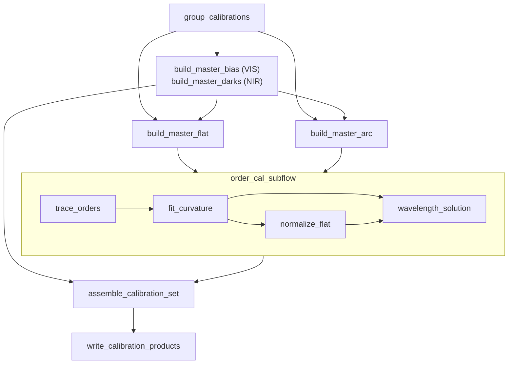
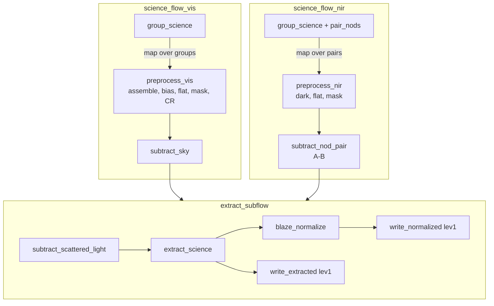

# Calibration Structure and Flow Catalog

## 8. Calibration Structure

This section covers Guidelines §11.2. A calibration epoch is a continuous interval with no change in instrument
configuration (detector settings, slit/R mode, mechanical state). Calibration association reads the epoch from
headers alone: `DATE-OBS`, the mode keywords, and the configuration keywords.

| Product | Built from | Epoch / lifetime                                     | Cache key inputs | Written to disk as |
|---|---|------------------------------------------------------|---|---|
| Master bias (CCD) | `IMTYPE=bias`, per channel | Afternoon set                                        | Bias frame fingerprints + `bias` settings | `<first>_mbias.fits` |
| Master dark (NIR) | `IMTYPE=dark`, per channel and `EXPTIME` | Afternoon set                                          | Dark fingerprints + settings | `<first>_mdark.fits` |
| Bad-pixel mask | Static mask + darks/flats | Static mask: instrument release. Dynamic part: night | Inputs + settings | `<first>_bpm.fits` |
| Master flat | `IMTYPE=flatlamp`, per channel | Afternoon calibration set                            | Flat fingerprints + master bias key + `flat` settings | `<first>_mflat.fits` |
| `TraceSet` | Master flat | Mechanical epoch; refreshed per afternoon set        | Master flat key + `trace` settings | `<first>_trace.fits` |
| Curvature (in `TraceSet`) | Master arc + `TraceSet` | Same as traces                                       | Arc key + trace key + `curvature` settings | Same file |
| `NormFlat` | Master flat + `TraceSet` | Afternoon set                                        | Flat key + trace key + `norm_flat` settings | `<first>_normflat.fits` |
| Master arc | `IMTYPE=arclamp`, per channel | Afternoon set (plus optional night arcs)             | Arc fingerprints + bias key | `<first>_marc.fits` |
| `WaveSolution` | Master arc + `TraceSet` (+ `NormFlat`) | Afternoon set                                        | Arc key + trace key + `wavecal_*` settings | `<first>_wavecal.fits` |
| `SensitivityCurve` | Standard-star science + reference spectrum | Night (default); any epoch by user choice            | Standard spectra key + reference ID + settings | `<first>_sens.fits` |
| Telluric model | Telluric standard or model fit | Per science exposure, or per standard                | Inputs + settings | `<first>_tell.fits` |

`<first>` is the filename stem of the first input file, so names follow `DRP-RUN-005`, e.g. `KB.20280101.12345_mflat.fits`.

Master calibrations are final products of the calibration flows. They are always written, and archived if KOA
selects them (`DRP-KOA-001`). The quicklook and science flows request them by cache key, so they get cache hits
instead of rebuilding them (Guidelines §5.3). If the night's set is incomplete, association falls back only to the
most recent earlier epoch with the same configuration. That choice is logged as a decision point (`DRP-RUN-009`) and
recorded in the product header.

Questions:
- Should calibrations (wavelength solution, sensitivity function) be saved with each science spectrum FITS (in extensions)?

## 9. Flow Catalog

This section covers Guidelines §11.3.

### 9.0 Arms, Channels, and Shared Subflows

Flows are defined per arm and parameterized by channel within the arm:

| Flow family | VIS (BLUE, GREEN, RED) | NIR (YJ, H, K) |
|---|---|---|
| Calibration | `cal_flow_vis` | `cal_flow_nir` |
| Quicklook | `quicklook_flow_vis` | `quicklook_flow_nir` |
| Science | `science_flow_vis` | `science_flow_nir` |

The arm flows differ only in their detector-level steps: frame preparation, zero-level calibration, and sky
treatment. The echelle steps after those are the same for every channel, so they live in two subflows that both arms
call:

- `order_cal_subflow(channel, master_flat, master_arc, config)` runs trace → curvature → normalized flat →
  wavelength solution.
- `extract_subflow(channel, frame, calibration_set, config)` runs scattered light → optimal extraction → blaze
  normalization → lev1 writes.

Each arm flow appears in full in the Prefect DAG. A step that exists in only one arm appears only in that arm's
flow, never as a branch the other arm skips at run time, so a VIS run never shows an idle NIR-only node.

### 9.1 `cal_flow_vis` and `cal_flow_nir`

```text
Flow name:           cal_flow_vis / cal_flow_nir
Purpose:             Build and cache all master calibrations for one channel and epoch.
Parameters:          channel (within the arm), epoch_id, frames: list[FrameRef], config
Input discovery:     group_calibrations task (IMTYPE, CHANNEL, configuration keywords)
DAG shape:           see diagram; VIS builds a master bias, NIR builds master darks per EXPTIME
Cached products consumed: none (bias/dark from the same run)
Products produced:   CalibrationSet + FITS files of Sec. 8
Concurrency model:   per-channel runs concurrent (process pool); within a channel sequential
Timing requirement:  done before the first science frame of the night needs it; on demand otherwise
Failure behavior:    a failed product fails only its dependents; CalibrationSet records which members exist
```



### 9.2 `quicklook_flow_vis` and `quicklook_flow_nir`

```text
Flow name:           quicklook_flow_vis / quicklook_flow_nir
Purpose:             Show the observer extracted 1D spectra and median S/N for one channel, refreshed after
                     every readout, so they can decide whether the observation is working.
Parameters:          channel (within the arm), frame: FrameRef (the frame just read out), ql_config (fixed,
                     minimal; optional order or wavelength-region selection), optional QL sensitivity function
Input discovery:     realtime_flow, on a change of the channel's detector LASTFILE keyword (KOA-DATA-001), or a
                     re-trigger from the GUI. The target/channel group the frame belongs to is read from headers
                     (PROGNAME, OBJECT, nod keywords), never from filenames (DRP-RUN-006)
DAG shape:           VIS: assemble -> subtract bias -> flat -> locate traces -> box extract -> apply wave
                          -> co-add into the channel's running QL stack -> QA
                     NIR: subtract dark -> (A-B / nod-and-shuffle sky, when the header identifies a pair) -> flat
                          -> locate traces -> box extract -> apply wave -> co-add -> QA
Cached products consumed: CalibrationSet for the channel if one exists (latest matching epoch); the channel's
                     running QL stack; the night's QL sensitivity function if one has been built
Products produced:   QL 1D per-order spectra for the frames taken so far, median S/N per channel and per order,
                     coverage and saturation flags, QA figure. Held in the cache; written to disk only on request
Concurrency model:   own work pool, so quicklook does not contend with the science pool on the same machine
                     (DRP-RUN-002); one run per channel, channels independent of each other
Timing requirement:  10 s per channel from readout to display (REQ-2-ZS-515), inside the ICD's 10 min / goal
                     1 min (DRP-RUN-001)
Failure behavior:    zero compute retries; failure appears in the GUI and blocks neither the next frame nor any
                     other channel
```

Quicklook runs per channel and independently of every other channel. A target normally has at least one exposure in
each channel, but the number of frames per channel can differ. After each readout the new frame is extracted and
co-added into that channel's running stack, so the GUI always shows the combination of the frames taken so far. The
co-add is incremental: the new frame's extracted spectrum is added to the running sum rather than the whole stack
being re-reduced, which is what keeps the cost per readout flat as a sequence grows and makes the 10 s budget
achievable for a long sequence.

Extraction is a box over the trace with a fixed height; quicklook does no optimal extraction (ICD Appendix B,
Quicklook mode). If a calibration set exists for the channel, quicklook uses its traces and wavelength solution. If
none exists yet, it locates the orders in the science frame itself, seeded by the nominal order centers in the
instrument package, and extracts from those. The product records which trace and wavelength source was used.

Flux calibration is not part of the automatic flow. The observer can select a standard-star observation in the GUI,
which adds a sensitivity-function step; the result is cached for the rest of the night and applied to that channel's
later quicklook reductions. This is a parameter of the same flow, not a second flow (Guidelines §5.3). Reusable QL
calibration products are cached with a night-long lifetime (§8).

In NIR, sky subtraction is automatic and driven by the nod keywords in the header. A frame whose nod partner has not
arrived yet is reduced without sky subtraction. When the partner arrives, the pair is reduced again. Both QL products
record which sky treatment was applied.

Scattered-light removal is not committed in either direction. Whether it runs by default depends on the measured
round-trip time with and without it, and whether it is exposed as a GUI toggle at all depends on whether it changes
what the observer decides (O-11).

Quicklook never writes to or alters a raw file. Its products stay in the cache and reach disk only when the observer
saves them from the GUI. The ICD permits this: it requires quick-look products to be *provided* within the timing
budget (`DRP-RUN-001`), not written or archived. The RTI integration covers raw data and "quick-look and/or
science-ready" reduced products, and the KOA night-time interface offers quick-look products only "if available". The
`file_write_hook` requirement is scoped by `DRP-KOA-004` to files "intended for inspection by a typical DRP user (i.e.
a fully reduced science output)", which Appendix B explicitly says quick-look data is not. Which products are archived
is decided by the Instrument Scientist and KOA Scientist at PSR (`DRP-KOA-001`); this design does not propose
quick-look products for archiving, and the science flow's lev1/lev2 products reach RTI on their own path (§15).

### 9.3 `science_flow_vis` and `science_flow_nir`

```text
Flow name:           science_flow_vis / science_flow_nir
Purpose:             Full-quality reduction of all science frames for one channel.
Parameters:          channel (within the arm), frames: list[FrameRef], calibration_set, config
Input discovery:     group_science task: groups by OBJECT and, in NIR, by nod/sequence keywords (visible fan-out)
DAG shape:           VIS: per group: assemble -> bias -> combine/CR -> flat -> (sky model) -> extract_subflow
                     NIR: per group: dark -> pair A-B / nod-and-shuffle -> combine -> flat -> extract_subflow
Cached products consumed: CalibrationSet
Products produced:   processed 2D frames, per-order 1D spectra (lev1), blaze-normalized spliced spectra
Concurrency model:   groups concurrent on a process pool; chain within a group sequential
Timing requirement:  none (automatic mode: completes before next-night checkout, ICD DRP Servers)
Failure behavior:    one group's failure leaves the others intact; run state COMPLETED_WITH_FAILURES
```

`preprocess_vis` and `preprocess_nir` are thin tasks over the eregion adapter. Both end with a `DetImage` carrying
its `std` plane and the mask planes each step added, so `extract_subflow` is the same for both arms.



The diagram shows both arms feeding one `extract_subflow`. At run time each arm calls its own instance; the diagram
only means that the extraction steps are shared.

### 9.4 `flux_and_stitch_flow`

```text
Flow name:           flux_and_stitch_flow
Purpose:             Flux-calibrate each channel and splice channels into one spectrum per object.
Parameters:          science results for all channels, standard-star identification, reference spectrum, config
Input discovery:     standard identified from header (target / IMTYPE / program keywords), not from a hard-coded name
DAG shape:           per channel: sensitivity_function -> apply_flux_calibration ; per object: telluric -> splice_channels
Cached products consumed: SensitivityCurve (cached per epoch), science outputs
Products produced:   flux-calibrated per-channel and stitched full-range spectra (lev2, final=True)
Concurrency model:   per object concurrent
Timing requirement:  none
Failure behavior:    if there is no standard, channels are written at blaze-normalized level and DRPSTATU=F for lev2
```

The alpha's `run_flux_calibration_and_stitch` takes the standard's name as a literal (`"STANDARD"`) and silently
defaults `EXPTIME` to 1.0. Both are removed (§20).

### 9.5 `night_flow` and `realtime_flow`

- `night_flow(input_dir, output_dir, config)`. Runs `discover_frames` (a fan-out task), then the matching arm's
  calibration flow (`cal_flow_vis` or `cal_flow_nir`) per channel and epoch, the matching arm's science flow per
  channel, and finally `flux_and_stitch_flow` across all six channels. The arm comes from the channel's header, through
  the instrument configuration. This is the body of `zsdrp-oneshot` and, mapped over directories, of
  `zsdrp-reprocess`.
- `realtime_flow(watch_dir, output_dir, config)`. A long-running loop. On each new file, which arrives from RTI or
  directory polling, it submits that channel's quicklook flow to the QL pool. On the summit the trigger is the
  per-detector `LASTFILE` keyword (`KOA-DATA-001`); off the summit it is directory polling. Calibration frames accumulate until their set
  is complete, then the arm's calibration flow is submitted. Science frames go to the arm's science flow once a
  calibration set exists; in NIR this happens once the nod pair or sequence is complete.
  The loop holds no reduction state; everything it knows is in the Prefect run history and the cache. That lets it
  run unattended for 24 h or more (`DRP-RUN-015`), keep memory flat (`DRP-RUN-019`), and resume after a restart
  (`DRP-RUN-017`).
