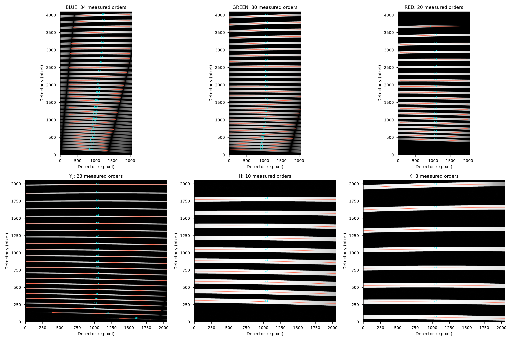
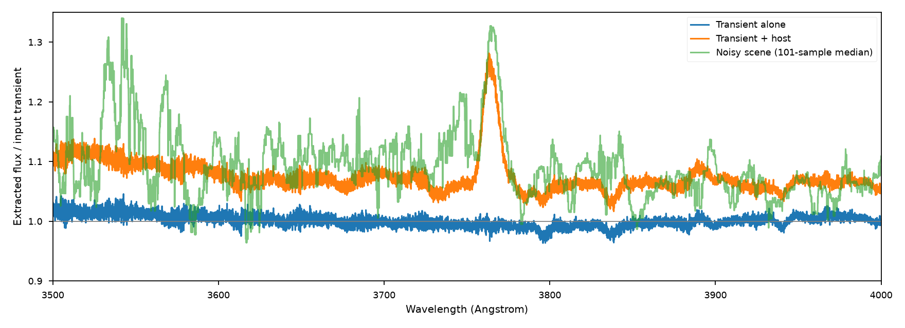
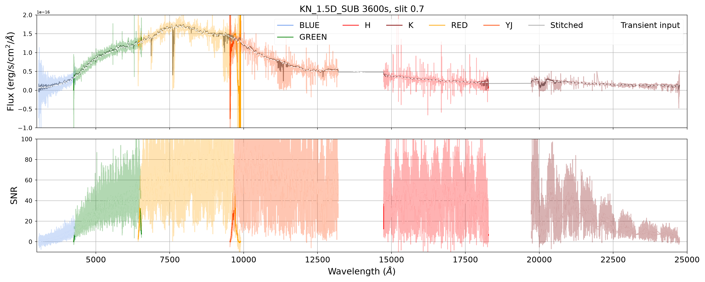
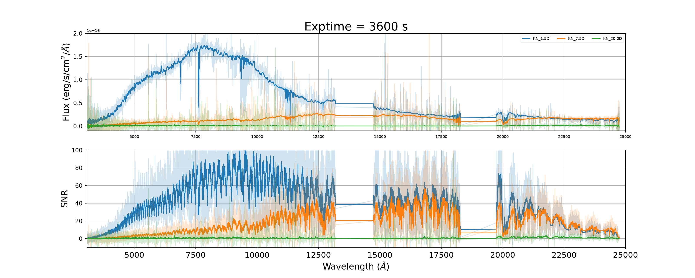

# Kilonova reduction after the ZShooter format change

The six-channel extraction, flux calibration and stitching now complete for the 1.5-, 7.5- and 20-day scenes. The original science frames were preserved and reused; bias, arc, full-slit flat, short-illumination trace and standard exposures were regenerated. The repaired run is in `zs-scopesim/notebooks/01_Kilonovae/kilonova_X-1.3_NS-0.7_dark_slit-0.7_ao-0_recalibrated`. The original directory is untouched.

## What broke and what changed

- RED now has 20 measured orders. An obsolete `free_spectral_range[1:]` left only 19 entries and caused the traceback. FSR bounds now follow each spectrum's physical order number, rather than its position in a list. Missing or reordered traces therefore retain the correct FSR.
- YJ's blue orders overlap in a full-slit flat. A separate 2-arcsecond illuminated TRACE exposure allows PyReduce to measure all 23 traces. The full-slit flat still supplies normalization. The quadratic trace fit and revised threshold retain the weak, partially illuminated order 80 without extrapolating it across the full detector.
- H's 100-pixel spatial edge crop removes two false edge detections. Its ten physical orders remain.
- Packaged FSRs use the configured spectrograph; wavelength guesses use the measured arc solutions at detector columns 0 and nx-1. Physical order numbers survive trace/wavelength save and reload. The package now includes these NPZ calibration inputs in built wheels.
- NIR flat and trace integrations are 2 s; their peaks remain below the configured 64,000-electron full well. The previous 3 s settings exceeded it.
- Disabling sky emission did not remove telescope/instrument thermal emission from the standard. Subtracting a matching 100 s blank corrects the K-band response. The standard remains AB=16, and the original throughput effects remain enabled.

## Measured traces and arc checks

Residuals below compare the model-assisted solution evaluated on each measured trace with fitted lamp-line wavelengths. Only positions inside the trace's measured column range are included. They are native detector pixels, not independent wavelength-calibration precision estimates.

| Channel | Physical orders | Traces | Lamp lines | Median absolute residual | 95th percentile |
|---|---:|---:|---:|---:|---:|
| BLUE | 85–118 | 34 | 648 | 0.040 | 0.143 |
| GREEN | 56–85 | 30 | 759 | 0.018 | 0.066 |
| RED | 37–56 | 20 | 220 | 0.029 | 0.106 |
| YJ | 58–80 | 23 | 162 | 0.022 | 0.058 |
| H | 42–51 | 10 | 80 | 0.016 | 0.060 |
| K | 31–38 | 8 | 57 | 0.016 | 0.061 |



The existing `simple_wavesol` still uses the configured optical trace model plus lamp measurements. PyReduce's native automatic initializer was also exercised on the first, middle and last measured order in every channel, with vacuum wavelengths. It still selects incorrect atlas lines: the median absolute differences are 0.098, 4.598, 16.238, 0.136, 0.066 and 0.107 pixels for BLUE through K, with much larger tails. Weak YJ order 80 is particularly unreliable. That cross-check failed; the native initializer has not replaced the model-assisted science solution. The executed demo and `native_wavecal_matches.csv` retain the result for further work, without a PyReduce fork.

## Flux and the host galaxy

The reference plotted in the kilonova notebook contains the transient alone. The simulated scene also contains its extended host galaxy, centered 10.5 arcseconds away. Blank-sky subtraction does not remove that galaxy. Consequently a scene/transient ratio above one is not, by itself, a photon-conservation failure.

The component test resolves the apparent 8% BLUE excess. Repeating the same observation without random draws, then applying the same extraction and standard response, gives a median flux/input-transient ratio of **1.0006 for the transient alone**, **0.0688 for the host alone**, and **1.0688 for their combined scene** over 3500–4000 Angstrom. The separately simulated source images sum to the combined scene with a summed absolute discrepancy of only **4.33e-8** of the scene's electrons. The host contributes real continuum and emission-line light.

Before extraction, a fixed ten-row aperture over the primary FSRs in that interval contains **737,705 measured electrons versus 735,280 expected**, or **+0.33% (1.37 sigma)**. The uncertainty includes the covariance from subtracting the same sky exposure twice: `Var(A0 + A1 - 2*sky) = Var(A0) + Var(A1) + 4*Var(sky)`. These checks show no 8% photon-count excess. The noisy extracted scene's integrated flux is **0.92%** above the expected extracted scene; that smaller residual has not been separated into extraction bias and noise. It should not be described as manufactured photons, nor silently counted as a passed sub-percent extraction test.



For the actual noisy 1.5-day frames, the median extracted scene flux divided by the input transient flux is:

| Channel | Wavelength interval (Angstrom) | Scene / transient |
|---|---:|---:|
| BLUE | 3500–4000 | 1.082 |
| GREEN | 4800–6000 | 1.011 |
| RED | 8000–8800 | 1.005 |
| YJ | 12000–13000 | 1.007 |
| H | 15500–17000 | 1.009 |
| K | 21000–22000 | 1.002 |

Before subtracting the standard's thermal background, the K ratio was 0.758. The response fit compensated for extra thermal counts in the standard and suppressed the inferred science flux. The corrected standard removes that bias.





The straight segments across wavelength gaps are plotting connections; there are no extracted samples in those gaps. The 20-day spectrum is largely a low-signal result and its flux/input ratio is not a useful accuracy metric.

## Uncertainties still need a separate repair

The current reduction does not propagate the independent sky exposure's pixel variance into PyReduce. Both science exposures reuse the same sky, so their errors also share a covariance term. `subtract_hduls` writes a scatter estimate from the two images rather than a propagated variance, and the extraction reads only the science extension. The fitted standard-response uncertainty is also absent. The SNR panels therefore remain current DRP estimates, not validated sensitivity predictions. This patch repairs extraction and calibration without adding a new variance framework; the performance notebook's explicit noise calculation remains the appropriate sensitivity calculation.

## Reproduce and verify

1. Run `zs-scopesim/notebooks/01_Kilonovae.ipynb` with `overwrite_cals=True` to regenerate calibration exposures and reduced calibrations after changing the instrument format. The expectation-value host check is separate from the noisy science exposures.
2. Run `zshooter-drp/notebooks/extraction_demo.ipynb` against the recalibrated directory. It exercises the individual reduction steps, the full pipeline, saved-calibration reuse, and the native wavelength-initializer cross-check.
3. Refresh stored wavelength guesses/FSRs after producing current reduced arc calibrations:

   ```sh
   python scripts/refresh_wavelength_ranges.py /path/to/arcs_0_BLUE.fits /path/to/reduced
   python -m pytest -q -p no:cacheprovider tests/test_order_calibration.py
   ```

Eight targeted tests cover physical-order FSR selection, all 20 RED orders, missing-order failure, zero flat response, trace save/load and the packaged order sets. A fresh six-channel reduction and reload produced identical wavelengths, extracted fluxes and uncertainties. The initial measured times were 222 s to build calibrations and reduce the full dataset, and 89 s with saved calibrations; these are reductions of multiple exposures, not single-observation timings.

Environment: `zssim`, Python 3.14.6, PyReduce-astro 0.9, ScopeSim `a0495f72`, IRDB `8c01711`. No ScopeSim, IRDB or PyReduce source was changed in this repair. The core reduction changes, executed demo and companion simulation notebook are committed separately on their existing `xshooter` branches; nothing was pushed.
