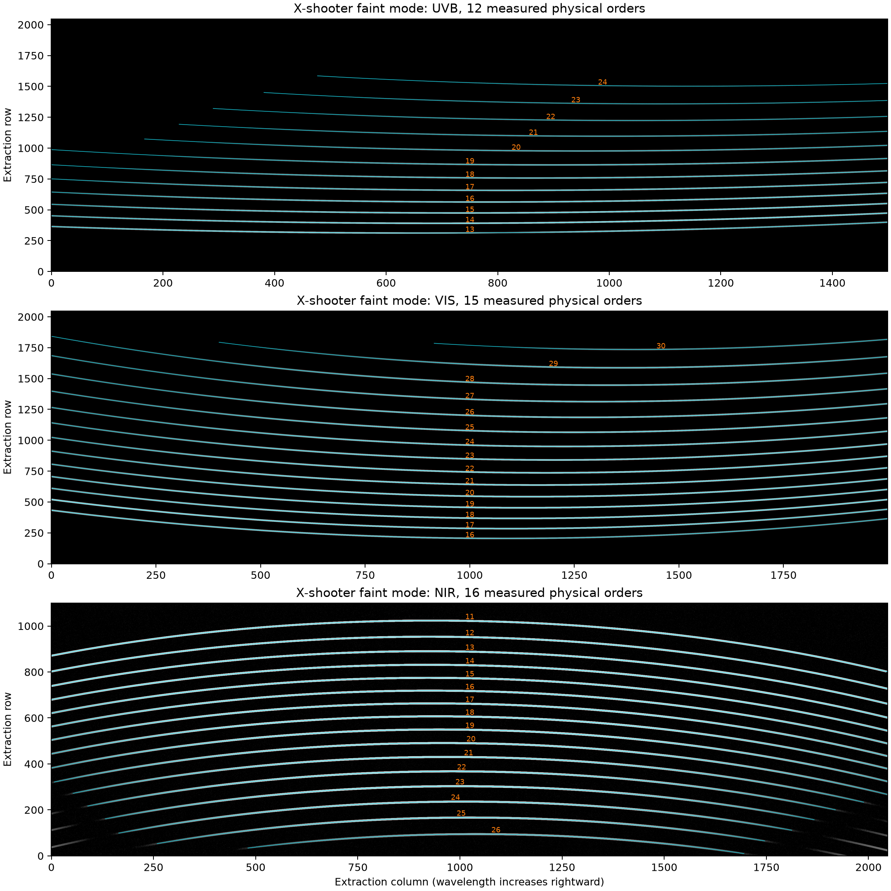

# Native X-shooter reduction and propagated pixel noise

`run_reduction` accepts the local `zsdrp.XSHOOTER.XSHOOTER` instrument and the configured ScopeSim trace list. Existing calls retain the ZShooter instrument default. The X-shooter path uses measured flat traces, fitted arc curvature, model-assisted vacuum wavelength calibration, native PyReduce optimal extraction, a measured standard response and order/arm stitching.

```python
from zsdrp.XSHOOTER import XSHOOTER

results = run_reduction(files, instrument=XSHOOTER(), trace_list=train['spectral_traces'],
                        lamp_lines=lamp_lines, output_dir=reduced_dir, require_variance=True)
```

`lamp_lines` contains the vacuum `wave` values in Angstrom and the same relative `amplitude` values used to generate the simulated lamp. The configured tabulated X-shooter traces supply detector coverage and physical order identity: UVB 13–24, VIS 16–30 and NIR 11–26. They do not use ZShooter's primary-FSR cuts.

The local instrument reads ScopeSim science data from HDU1. It rotates UVB clockwise and VIS counterclockwise so wavelength increases with extraction column; NIR remains in its native orientation. Wavelength evaluation reverses these rotations before using the original detector WCS. Native ADU are converted to accumulated electrons with the configured gain; averaged NIR outputs additionally multiply by NDIT. Prepared electron frames are already summed and retain their count scale. The dark-current header remains a rate in electrons/second; prepared `RON` describes the combined read-noise standard deviation.

The variance and physical slit-residual-coordinate APIs require the sibling `PyReduce-xshooter` checkout's `xshooter` branch. Published PyReduce 0.9 does not contain these additions. The companion simulation repository's environment manifest records the tested local revisions; those unpublished commits must be obtained from this workspace before reproducing the environment elsewhere.

## Variance-aware science inputs

Supply one prepared file per object and arm, with the summed, sky-subtracted signal in HDU1 and its pixel variance in an extension named `VARIANCE`. `BUNIT=electron`, `GAIN=1`, `COMBINE=sum`, `EXPTIME` is the on-source integration, and `SUBTRACTED=True`. Variance is in electron squared and includes source, sky, dark and read terms. A native ADU input is also supported: its variance undergoes exactly the square of the data's conversion and the same pixel rotation.

Combine exposures before extraction using their actual coefficients. Independent sky frames and a reused sky exposure are different measurements: `A1+A2-2B` has variance `VA1+VA2+4VB`. The DRP does not infer those associations from previously subtracted images. `require_variance=True` makes a missing variance extension fail. The original no-variance extraction remains available for existing notebooks, but it uses PyReduce's legacy residual-based uncertainties.

The prepared variance is divided by the square of the normalized flat and passed to the revised PyReduce optimal extraction. Its spectral covariance includes the fitted spatial profile and overlapping swaths. The DRP carries covariance through blaze division, retained order ranges, response/exposure scaling and stitching. FITS outputs retain the sparse covariance; ASCII exports contain its diagonal standard deviation only. The standard reference is supplied in erg/s/cm2/Angstrom. Response-calibrated science products carry this flux-density `BUNIT` and the corresponding squared `COVUNIT`. The standard itself remains an electron/second rate diagnostic and is saved with the `_blazecal` suffix; it is not mislabeled as calibrated flux.

The reported science covariance is conditional on the measured traces, wavelength solution and high-S/N calibration products. Their sampling uncertainty is a separate calibration-realization experiment. Variance-aware stitching cuts between overlapping pieces using the measured response without fitting additional noisy multiplicative offsets. This preserves correlations within each retained piece; source samples from different detector orders are independent under the fixed-calibration calculation.

## Verification

The focused tests cover native detector rotations, summed versus averaged count units, covariance through blaze and response scaling, retained correlations after order selection, and saved physical flux units. The existing physical-order/FSR tests remain in the suite. Full 34-order BLUE extraction of the preserved 1.5-day kilonova frame completed with finite positive uncertainties and covariance diagonals equal to their squares. Some faint profiles exceeded the earlier 100-iteration budget. The shared science setting permits at most 1,000 iterations with the unchanged stopping tolerance and early exit. ZShooter BLUE permits 2,000: its faint 7.5-day profile converges at iteration 1,190 to the identical solution with trial caps of 2,000 and 4,000. This increases the bounded iteration allowance without changing the fit or accepting an unconverged result. ZShooter GREEN permits 3,000 after the 20-day swath required 2,083 native iterations; the refined fit agreed with an independent lower-cap-plus-Newton solution to 1.9e-11, retained its rejection mask, and added 0.38 seconds for that swath. Signed, weakly constrained faint profiles retain their warnings and propagated uncertainty. The accelerated evaluation of the same converged fit reduced this arm's measured extraction time from 92.2 to 37.5 seconds.

## Calibration assessment

The noisy companion-notebook calibration frames recover all 43 configured orders in both slit/binning configurations. Wavelength increases along every extraction row. The flat used the full 11-arcsec slit; the order-definition exposure illuminated its central 2 arcsec. The measured order traces below are drawn directly over those frames; the image display uses a logarithmic 30–30,000-electron range.



| Faint-mode arm | Physical orders recovered | Accepted isolated arc lines | Arc residual scatter, native pixels |
| --- | --- | --- | --- |
| UVB | 13–24 (12) | 11 | 0.030 |
| VIS | 16–30 (15) | 58 | 0.030 |
| NIR | 11–26 (16) | 140 of 141 | 0.057 |

The wavelength solution is explicitly assisted by the configured physical trace model. UVB's accepted lines occur only in orders 22, 23 and 24 (1, 3 and 7 lines respectively). Orders 13–21 therefore retain the model's wavelength mapping plus the arm-wide two-parameter pixel correction. VIS has no accepted isolated lines in orders 26 and 30; NIR has none in order 26. The quoted residuals describe the matched-line support. The remaining orders' wavelength accuracy depends on the adopted trace model.

| Higher-resolution arm | Physical orders recovered | Accepted isolated arc lines | Arc residual scatter, native pixels |
| --- | --- | --- | --- |
| UVB | 13–24 (12) | 82 of 83 | 0.059 |
| VIS | 16–30 (15) | 190 of 197 | 0.076 |
| NIR | 11–26 (16) | 124 of 127 | 0.054 |

In this configuration every UVB/VIS order has an accepted line; NIR order 26 still has none. The wavelength fit retains the global two-parameter correction for orders with fewer than three accepted lines, adds a constant correction with three to seven lines, and fits an order-specific linear correction with at least eight. Both tables quote the residual scatter after the global fit and its three rejection iterations; they do not describe independently fitted wavelength polynomials in every order.

Two calibration settings needed adjustment with the real frames. Curvature fitting over 0.8 of the order spacing extended beyond the illuminated slit, tracked background noise and produced impossible hundreds-of-pixels shifts. It now uses the central 40 spatial pixels, and flat normalization uses 60 pixels in UVB/VIS and 50 in NIR. The point-source extraction uses 10 spatial pixels. Residual slit offsets retain their measured pixel coordinates as these apertures change; old calibration products lacking those coordinates must be rebuilt. NIR tracing also requires a threshold appropriate to its 25.6-electron short-integration read noise: thresholds of 20, 30 and 40 electrons after nine-column smoothing all recover the same 16 orders, while the CCD threshold of 2 electrons admitted noise clusters. The selected threshold is 30 electrons.

PyReduce currently warns about decreasing trace row positions when saving these files: its tracing routine deliberately sorts order numbers downward, while its generic save validator expects increasing row position. The saved trace order is unchanged; wavelength rows and physical-order identities are checked together when calibrations are reused. This warning does not indicate a crossed or reversed wavelength solution.

STANDARD and flat-AB extraction now complete in all three faint-mode arms with full covariance (21.4/35.4/36.0 seconds for the pair of objects in UVB/VIS/NIR). Across all retained native samples, UVB/VIS recovered/input AB-continuum flux has medians 0.997/0.992. NIR's all-sample median is a poor closure statistic because it mixes deep telluric absorption and correlated low-S/N samples. Integrating specified clean intervals, with the full covariance, gives:

| NIR interval, microns | Integrated recovered/input flux | Propagated 1-sigma uncertainty |
| --- | --- | --- |
| 1.02–1.10 | 0.975 | 0.058 |
| 1.17–1.31 | 0.981 | 0.045 |
| 1.50–1.75 | 0.875 | 0.083 |
| 2.05–2.30 | 0.947 | 0.064 |

The H-window deficit is 1.5 sigma in this realization. Expected-source images, recovered as prepared variance minus twice the matching blank variance, have the correct AB-magnitude/exposure scaling. Reducing those expected images preserves that scale for H orders 15–17. A bounded independent test of order 16 gives mean recovered/truth 1.0127 with standard error 0.0207 over 12 Poisson-plus-effective-read-noise realizations; their scatter is 0.0717 and their RMS reported uncertainty is 0.0895. These results do not support a systematic 12-percent extraction loss or an exposure/gain correction. The existing estimator is retained.

The repeatable check is `scripts/validate_xshooter_noise.py DATA_ROOT CALIBRATION_DIR`. It uses the actual prepared source/blank variance, configured effective read noise, measured trace and flat; fits columns 500–1500 of order 16; integrates central columns 650–1350; and uses random seed 32189. Calibration products are held fixed, as for the science covariance. The comparison notebook's finite wavelength-bin plots retain the wavelength dependence hidden by these integrated summaries. The complete notebook execution additionally checks both configurations on the three kilonova phases.
